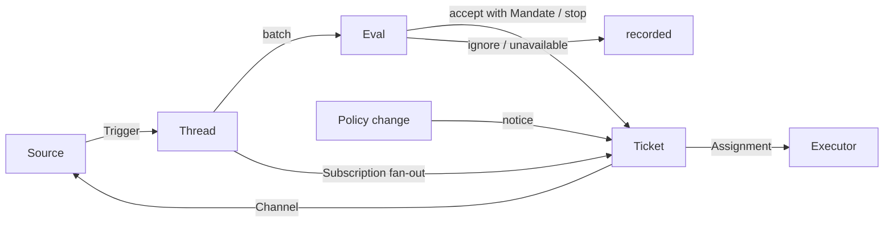

# 001 领域模型

本文档定义 dsh-superagent 的概念以及每个概念遵守的规则。代码、智能体调用的工具、面板和其他文档都只使用这些术语，不用其他说法。遵循 [000 理念](000-philosophy.md)，模型只包含工作所需的概念，业务需求成为其中某个概念的属性。

## 流程

工作从触发器经过评估进入执行。来源产生触发器。触发器作为上下文扇出给订阅了其线程的工单。以这种方式抵达工单的人的消息留在该工单；其他每个触发器都进入评估，由评估决定是否请求新工作。评估接受时，创建一个带授权的工单。派工把工单交给执行器，结果通过渠道回到来源。

## 概念

来源、线程、评估、授权和订阅构成核心领域；其余概念为它们提供支持。

| 概念 | 定义 | 遵守的规则 | 存在的原因 |
| --- | --- | --- | --- |
| Source | 事件流。来源类型是可复用的实现；来源实例是某个类型的一份配置：是否运行、监听什么 | 保存自己的读取位置和自己的机器人身份。定义什么算一个事件，包括只在时间上成立的条件。在机器人自己的消息和监听范围之外的触发器进入领域之前将其丢弃。把每个触发器翻译成它所属的线程和用于回复的渠道地址 | 重启不能重放事件 |
| Trigger | 带来源自身元数据（例如其行动者）的一个不可变事件 | 属于一个或多个线程。同一个触发器被接受两次只创建一个工单 | 审计与幂等的单位 |
| Thread | 按时间顺序排列的触发器；由来源定义哪些触发器构成一个线程 | 同一时间至多运行一个评估。可以有多个工单。保存其订阅、运行中的评估及其决定历史 | 为评估提供一致的视图和上下文 |
| Correlation | 一个触发器所属的多个线程之间的关系 | 只补充上下文；从不路由 | 让评估追踪相关证据 |
| Channel | 线程的写入侧；由来源定义其地址 | 一个线程可以有多个渠道；一个工单持有一组渠道 | 确认、回复、拉取请求和已解决的评审都属于写入 |
| Policy | 带版本的评估规则，以及每个来源的部分：谁能通过该来源、以该来源自己的身份发起工作，名单如何同步，以及哪些机器人可以产生候选 | 策略版本涵盖规则、接单模式和来源部分。影响进行中工单的变更（例如它接单时所依据的规则发生变化）会投递到其派工；但不会撤销授权。不同来源上的身份绝不互相映射 | 规则变化时，运行中的评估必须被丢弃 |
| Eval | 对一批触发器的判断，分两层：准入和评估 | 输入：触发器批次、线程快照、该线程上的所有工单（包括已结束的），以及当前策略。输出：一个决定。不保存状态 | 决定新工作是开始、继续还是停止 |
| Mandate | 接受所授予的内容：策略版本、范围、强度、匹配的规则、发送者在该来源上的身份，以及来源如何收到该触发器 | 不可变；范围更大意味着新工单。工单结束不会结束授权：只有人的停止会撤回它，不再满足它的策略会撤销它。已结束的工单恢复前会按当前策略重新校验 | 说明工作为何可以做，以及能做多远 |
| Ticket | 获授权工作的单位 | 只有评估能创建；唯一的额外入口是已配置的定时任务源，它按配置直接准入并以 `scheduled` 授权依据记录（流水线任务源）。引用其授权；持有其渠道和输入。从打开 → 结束，当人就在其某个线程上的消息恢复它时回到打开，除非有人停止了它。定义自己的状态，而不跟随执行器的状态 | 拥有执行及其报告 |
| Assignment | 工单与一个执行器实例的绑定 | 一个工单随时间有多个派工。独立于工单从待启动 → 执行中 → 已结束。只有其最终报告可以在执行器一侧结束工单 | 执行器在领域之外，但由谁执行必须记录在领域内 |
| Subscription | 工单与线程之间的多对多关系，由线程持有 | 匹配的触发器扇出到每个存活的已订阅工单，不检查发送者是谁；以这种方式抵达工单的人的消息不经评估。执行器为获取上下文而关注的线程同样能把消息送到其工单，但不授予授权，也不会恢复工单。已结束的工单保留其订阅，包括已关闭或已合并的拉取请求的订阅：人的消息会在同一授权下恢复它，不经评估或决定；机器人和 CI 的消息不会抵达它，因为其执行器恢复时会重新读取线程。被人停止的工单不再收到任何东西。主会话只在消息明确指向某个工单时，才把线程关联到该工单。人可以取消线程上的所有订阅；执行器只能取消自己工单对某个它认为无关的线程的订阅，但工单起始所在的线程和来源让它关注的线程（例如它的拉取请求）除外 | 后续讨论无需再次 @ 智能体就能抵达执行器 |

人不是领域概念。触发器携带来源给出的行动者标识符。允许名单是策略在某个来源上的部分，使用该来源的身份。同一个人在多个来源上都有账号，这属于智能体按需阅读的提示词文本。

执行器及其会话和目录在领域之外，通过派工连接。

聚合：来源持有其读取位置。线程持有其订阅、运行中的评估（串行运行，并把期间到达的触发器合并进下一批）及其决定历史。工单持有其派工、渠道和输入，并通过 id 引用决定。

## 被否决的概念

| 被否决 | 原因 |
| --- | --- |
| 把主体或成员关系作为实体，或在来源之间映射身份 | 人是触发器元数据；允许名单是策略在来源上的部分；跨来源映射是提示词文本 |
| 由评估调度自己的延迟触发器 | 需要等待的条件就是一个普通来源，因此评估永不反向依赖来源 |
| 等待中或已撤销的评估状态 | 等待属于来源；超时的评估把触发器重新排队，或以 `unavailable` 结束 |
| 每个线程至多一个存活工单 | 一个线程可以承载多项独立工作；评估通过工单列表避免重复 |
| “追加到工单”这种决定 | 追加就是订阅扇出，不需要评估 |
| 对订阅做准入检查 | 订阅覆盖整个线程；授权把授权与上下文分开 |
| 会进行路由的关联 | 订阅负责路由；关联只补充上下文 |
| 跟随 DSH 会话的工单状态 | 工单可以被移交、恢复或由多个执行器运行，因此它定义自己的状态 |
| 由执行器声明有人要求它停止 | 只有评估决定结束的强度 |
| 策略变化时取消运行中的工单 | 被取消的变更会留下半成品；应当记录并投递该变更 |
| 执行器失败或阻塞时锁定其会话的所有工具 | 这会拒绝人直接在会话中工作，也会拒绝恢复后的报告；暂停自动输入就够了 |
| 从报告的自由文本推断“在等人” | 分类需要结构化事实；执行器通过结构化字段提问 |

## 可复用的部分

上述概念及其规则是可复用的。来源实现、策略内容、执行器和渠道实现属于某次部署。每个来源在内部保留自己的说法，例如消息、群或通知，并把它翻译成触发器。

| 部分 | 在本仓库中 |
| --- | --- |
| 来源 | 飞书：实时事件、历史恢复、已订阅话题的轮询。GitHub：通知、已订阅的 Issue 和拉取请求、CI 变化、已合并或已关闭的拉取请求，以及在开启时，仓库中每个新 Issue、拉取请求和评论，以及默认分支的 CI。GitLab：已订阅 Issue 和合并请求的轮询，以及在开启时，项目中每个新 Issue、合并请求和评论 |
| 策略 | 评估规则，以及每个来源的允许名单、同步、机器人名单和准入表 |
| 执行器 | 每个工单一个 DSH 执行器会话和一个目录，位于执行环境中，其变量由执行器和来源注册 |
| 渠道 | 飞书话题回复，GitHub 评论和评审线程回复，GitLab 在 Issue 和合并请求上的评论 |

## 术语表

本文档和后续文档使用的术语参考列表，并给出中文名称；后续文档会解释上文未引入的术语。面板一次只显示一种语言；它的 (?) 按钮会以双语打开本术语表。智能体发给 GitHub 和飞书上的人的消息使用平实语言，而不是这些术语。

| 术语 | 中文 | 含义 |
| --- | --- | --- |
| Agent | 智能体 | dsh-superagent 运行的自动化团队成员，通过 GitHub 账号和飞书机器人等身份在来源上行动 |
| Main Session | 主 Session | 评估触发器、接单并派发工单、负责回复的 DSH 会话；代码和提示词中称 `orchestrator` |
| Executor Session | 执行器 Session | 执行器为一个工单运行的 DSH 会话；代码和提示词中称 `worker` |
| Source | 来源 | 事件流：内置适配器提供的类型，加一份记录配置 |
| Trigger | 触发 | 来自来源的一个不可变事件 |
| Thread | 线程 | 按时间顺序排列的触发器；同一时间只运行一个评估的单元 |
| Correlation | 关联 | 共享同一触发器的线程之间的关系；只补充上下文 |
| Channel | 渠道 | 线程的写入侧 |
| Policy | 策略 | 接单的带版本规则，以及每个来源在其中的部分，例如谁能在那里发起工作 |
| Policy version | 策略版本 | 规则、来源部分和接单模式某一组合的标识符；每个授权都记录它 |
| Eval | 评估 | 把一批触发器变成决定的过程 |
| Gate | 准入 | 评估的第一层，确定谁能发起工作以及强度多少 |
| Assessment | 研判 | 评估过程中模型的判断 |
| Decision | 决定 | 评估的结果 |
| Mandate | 授权 | 接受所授予的内容：强度、范围以及所依据的策略版本 |
| Ticket | 工单 | 获授权工作的单位 |
| Assignment | 派工 | 工单与一个执行器实例的绑定 |
| Subscription | 订阅 | 工单与线程之间的关系 |
| Fan-out | 扇出 | 把已订阅线程的触发器作为上下文送达工单 |
| Executor | 执行器 | 运行派工的端口：每个工单一个执行器会话和一个目录 |
| Execution environment | 执行环境 | 执行器会话和准备命令运行的地方：由执行器和来源注册的变量，每个变量有键、值和说明 |
| Report | 报告 | 派工向工单报告的状态 |
| Attention | 待人工决定 | 工单上等待人回答的问题 |
| Disposition | 去向 | 触发器被过滤、评估或扇出的记录 |
| Input | 输入 | 送达工单的上下文：扇出的触发器、策略变更、恢复和文本 |
| Scope | 范围 | 授权允许的工作 |
| Strength | 强度 | 授权或评估依据的强度 |

| 分组 | 取值 |
| --- | --- |
| Decision | accept 接单 · stop 停止 · ignore 忽略 · unavailable 未完成 |
| Strength | explicit 明确 · inferred 推断 |
| Assignment | pending 待启动 · running 执行中 · ended 已结束 |
| Report | progress 进展 · waiting 等待 · ready 就绪 · blocked 受阻 · failed 失败 · dropped 无需处理 |
