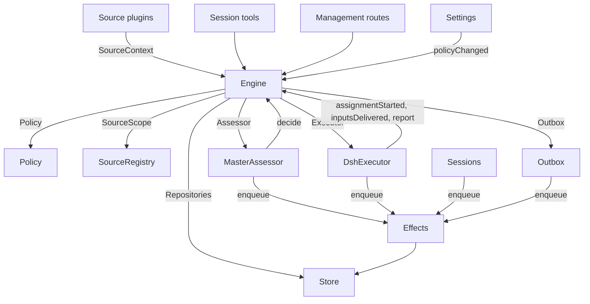

# 007 架构

这是实现的开发者指南。它把 [001 领域模型](001-domain.md) 到 [006 部署](006-deployment.md) 中的概念映射到类、接口和文件。先从运行时和 Engine 开始，再把模块表和测试表当作代码索引使用。

## 核心类与胶水层

核心类以小接口拥有领域概念和外部边界。胶水层把工具参数、HTTP 请求、来源载荷和 DeepSeek Harness 事件翻译成对这些类的调用，再把结果变成卡片、视图和消息。

`Runtime`（`src/app/runtime.ts`）构造应用、提供依赖，并负责启动和关闭。`Engine` 构造自己的内部部件。执行器和评估器会回调 Engine，因此 Runtime 给它们的是 getter，而不是要求按循环顺序构造。

### Runtime

`Runtime` 是组合根；它不包含领域规则。其构造函数锁定状态目录、打开 Store 并构建各个组件。构造失败时，它关闭 Store 并释放锁。

启动时注册管理路由并运行安装。安装解析完成后，它安装会话和执行器钩子、确保主会话存在、启动策略同步、恢复被中断的派工，并启动轮次和副作用。`ready` 标记启动完成。

关闭时取消回合，等待轮次、副作用和智能体，恢复进程环境，关闭 Store 并释放锁。内置来源适配器通过狭窄的 `SourceHost` 接口取得 registry 与逐记录上下文；主插件是唯一注册它们的地方。

| 部分 | 模块 | 作用 |
| --- | --- | --- |
| Setup | `src/app/setup.ts` | 按执行器 shell 的方式探测各 CLI，解析仓库和账号，写入并应用执行器环境和命令垫片，并保留安装问题；设置通过它检查变更的账号，并通过它重启，从而再次运行安装 |
| Passes | `src/app/passes.ts` | 一次一个轮次，每两秒以及任何命令请求时运行：先处理到期的副作用，再运行 `Engine.evaluateDue`；来源的触发器通过它抵达 Engine |
| Outbox | `src/app/outbox.ts` | Engine 的 `Outbox` 端口，也是回执的唯一写入者：`send` 在一个事务中保存消息回执并排队其 `reply` 副作用，副作用处理器通过 `SourceRegistry.send` 发送；来源关闭期间消息等待，对话已消失或不再被监听时消息被丢弃 |
| Notices | `src/app/notices.ts` | 把领域事件和执行器活动转换成主会话消息。`eventNotice` 处理领域通知；`reportRelay` 立即转发问题，把普通进展留在其工单上，并中继其他报告；`followupRelay` 指明拥有人工跟进的工单。回合期间到达的中继会通过 DeepSeek Harness 收件箱在下一步一起投递 |

### Engine

`Engine`（`src/core/engine.ts`）是触发器、线程、决定、工单和派工的唯一写入者。它从 `src/core/ports.ts` 接收这些端口：`Repositories`、当前策略 getter、`SourceScope`、`Assessor`、`Executor` 和 `Outbox`。可选依赖是 `prepareTicket`、`now` 和 `emit`。

Engine 的所有方法都是同步的。每条命令在一个事务中修改其聚合。`evaluateDue` 为它修改的每个评估或工单使用单独的事务。端口在事务内排队外部工作；适配器在提交后执行。无效请求抛出 `UserError`。

Engine 暴露一个入口点，并委托给五个内部部件。它拥有每条命令的事务。跨部件的命令（例如 `attach`、`evaluateDue` 和 `policyChanged`）按顺序调用各部件。

每个部件都扩展 `EnginePart`（`src/core/part.ts`），后者提供选项和共享读取。部件之间的依赖只朝一个方向流动：

| 部件 | 职责 | 依赖 |
| --- | --- | --- |
| `Intake` | 来源的触发器：连同其去向存储一次，记录在其线程及其关联上，扇出给已订阅的工单，并且除非它是抵达某个工单的人的消息，否则在其主线程上排队等待评估 | Tickets |
| `Evals` | 线程的评估：批处理、准入层的强度、行动者和依据（由其触发器 `primary` 给出）、从候选投递开始的截止时间及其因暂停的顺延、过期评估的重新入队、候选、重放和交回、策略变更时的重新入队，以及每次评估最终给出的决定：accept、stop、ignore 或 unavailable | Tickets |
| `Tickets` | 工单生命周期：由接受创建及其授权、订阅和首次派工，它关注的线程及其关闭（`followsDone`），被关联的线程和仅作上下文关注的线程，输入和备注，恢复以及恢复拒绝的消息，重试、重启、停止和结束，它取消的订阅，以及向受策略变更影响的工单发送通知 | Replies |
| `Assignments` | 执行器及其执行器报告的内容：派工已启动、输入已抵达或投递失败、重启中断了派工，以及执行器报告及其向人提出的问题 | Tickets、Replies |
| `Replies` | 通过 `Outbox` 写渠道：确认、回答、结果和待人工决定消息，各按允许它的规则 | 无 |

命令使用祈使式名称，例如 `stopTicket`；适配器报告的事实使用过去式名称，例如 `assignmentStarted`。查询 `candidate` 使用名词。

调用者只收到其角色对应的 Engine `Pick`：`EngineForSources`、`EngineForMainSession`、`EngineForPeople`、`EngineForSettings` 或 `EngineForExecutor`。

| 角色 | 方法 | 效果 |
| --- | --- | --- |
| 来源 | `receive(trigger)` | 存储触发器一次，并答复 `stored`、`duplicate`，或在没有来源接收时答复 `filtered`；把它扇出给订阅其线程的工单，其中人的消息会立即恢复已结束的工单，除非处理已暂停；并在其主线程上排队等待评估，除非它是抵达工单的人的消息，那将留给该工单 |
| 来源 | `bindThread(ticketId, thread, own)` | 让打开的工单关注来源的某个线程（例如拉取请求的线程），工单打开它时 `own` 为真；已关闭的线程再次绑定后会重新打开。结束工单的是线程的关闭，而不是 `ready` 报告 |
| 来源 | `threadClosed(thread, outcome, at)` | 线程已关闭：每个关注它的打开工单记录该关闭，并在它关注的线程都处理完毕（`followsDone`）后结束：它打开的线程都不再打开，或当它没有打开任何线程时，它关注的所有线程都已关闭。它按这些关闭中最新者的结果结束为 `merged` 或 `closed`，除非关闭后恢复的工作尚未报告 `ready`，或其执行器接手了某个人工跟进（通过确认或回答）而该跟进是在其最新非 `progress` 报告之后、或在上个回合结束后才被决定的；此后的 `dropped` 报告会按关闭结果结束它 |
| 主会话 | `candidate(triggerId)` | 持有某触发器的评估，按其评估器所见 |
| 主会话 | `candidateDelivered(evalId)` | 评估的候选已抵达主会话：其截止时间从此刻计算 |
| 主会话 | `decide(triggerId, outcome)` | 记录评估决定，或为明确请求记录直接决定。接受会原子地创建工单、授权、派工、订阅和确认。被从卡片忽略的推断候选会在所给理由之前记录 `ignoredFromCard`。当 `followupOwners` 仍拥有人工跟进时，只允许停止 |
| 主会话 | `attach(ticketId, triggerId, note?)` | 把触发器路由到它所指向的工单，其执行器随后把它作为跟进决定，并结束持有它的评估，该评估的其他触发器等待新的评估；已结束的工单会在其授权下立即恢复，除非处理已暂停。执行器仍在决定的跟进会被拒绝，路由回交回它的工单也会被拒绝 |
| 主会话 | `requestStatus(ticketId)` | 向等待中的执行器会话请求状态，并答复是否已请求 |
| 主会话 | `note(ticketId, text)` | 把其他工作的事实作为文本输入交给工单的执行器，这不授予任何权限 |
| 主会话、执行器 | `reply(request)` | 按用途为渠道排队消息：`acknowledgement`、`answer`、`result` 或 `attention` |
| 人 | `stopTicket(ticketId, reason?)` | 人的停止，会撤回授权 |
| 人 | `retryTicket(ticketId)` | 结束在 `failed` 或 `blocked` 报告之后等待人的工单的停滞派工，或输入投递失败的派工（`canRetry`），并启动新的派工 |
| 人 | `reevaluate(triggerId)` | 把已存储的触发器排队以进行新的评估 |
| 人 | `unsubscribe(thread)` | 取消线程上的所有订阅，曾关注它的工单不再关注它；各自继续决定它在那里收到的跟进 |
| 人 | `dismiss(decisionId)` | 忽略 `unavailable` 决定所显示的问题，该决定会记录此操作 |
| 执行器 | `assignmentStarted(ticketId, assignmentId)` | 派工开始运行；其等待中的输入发出 |
| 执行器 | `inputsDelivered(ticketId, assignmentId, inputIds)` | 输入抵达派工的执行器会话，每条等待某个步骤纳入 |
| 执行器 | `inputsRead(ticketId, inputIds)` | 执行器会话把携带这些输入的消息纳入历史（`user/message` 会话事件），模型由此获得它们；认领后在被取消或失败前未完成的步骤不算。每条输入在随后出现报告或回合结束时算作已读，重启后也是如此，工单结束也不会释放它；在读取记录之前投递的输入，在其投递后出现报告或回合结束时算作已读 |
| 执行器 | `turnEnded(ticketId, assignmentId)` | 执行器会话的一个回合结束，报告之后也同样，前提是它没有后台运行的工作，或正在移交给 |
| 执行器 | `deliveryFailed(ticketId, assignmentId, error)` | 投递输入失败；工单会显示它，直到投递成功、新派工开始或工单结束 |
| 执行器 | `report(ticketId, report)` | 记录报告及其向人提出的问题；`dropped` 结束工单，`ready` 会完成不关注任何线程的工单，并按线程结束的方式结束已处理完其所关注线程的工单 |
| 执行器 | `markUnrelated(ticketId, thread, reason)` | 仅取消该工单对某个它认为无关的被关联线程的订阅，并带理由交回该工单在那里决定的跟进 |
| 执行器 | `followForContext(ticketId, thread)` | 让打开的工单订阅相关线程以获取上下文：其消息抵达工单，但不授予跟进强度，也不会恢复它 |
| 执行器 | `handback(ticketId, triggerId, reason)` | 记录工单交回抵达它的触发器，理由随候选携带；一旦没有其他工单决定它，就为它排队新的评估（如果由本工单决定）；答复是否入队。工单对每个触发器只交回一次，并保留其订阅 |
| 执行器 | `assignmentInterrupted(ticketId, assignmentId)` | 宿主停止时派工正在运行：工作中被中断的，或在最新报告之后又收到输入的，会带恢复备注重新开始，并带上投递给它但执行器会话未纳入的输入，如同重试；自那以后已报告过的派工保留其会话。DshExecutor 在启动时报告每个此类派工（`resume`），最旧的工单优先，并重新排队等待中的启动 |
| 轮次 | `evaluateDue()` | 除非处理已暂停：启动那些有排队触发器等待的线程的评估，每个线程一次，把期间排队的触发器作为一批；把超过截止时间的评估的触发器再次排队，连续两次，第三次记录为 `unavailable`；并恢复暂停期间人的消息所抵达的已结束工单，前提是其授权仍然成立。候选尚未抵达主会话的评估不会过期。处理暂停期间没有评估过期，恢复后每个截止时间按暂停时长顺延 |
| 设置 | `policyChanged(from, to, effects)` | 告知每个存活工单变更如何影响它（`src/policy.ts` 中的 `policyEffects`：它接单时所依据的规则发生了变化或不再适用、其请求者可能不再能发起工作，或不再接受主动工作），并按新版本重启进行中的评估 |

Engine 把批处理、授权、扇出、恢复和待人工决定生命周期规则保持为私有。几个共享谓词让这些规则保持一致：

- `waitsForPerson`（`src/core/model.ts`）：最新派工报告了 `blocked` 或 `failed`，且此后没有人的消息到达。在此期间，自动输入和失败的启动保持挂起。
- `followupOwners`：仍对其自己线程上收到的人工跟进负责的工单。工单可以存活，或已结束但没有被人停止、正等待恢复。交回该消息会结束这种拥有关系。
- `settled`：某个决定解决了请求；停止、不可用、已路由和拒绝停止的决定不算。
- `ticketStage`（`src/core/stage.ts`）：实现 [003 执行](003-execution.md) 中的阶段表。

工单结束时，未读的跟进返回评估，除非另一个工单仍拥有它们，或另一种去向已处理它们。已确认、已回答和已交回的消息被排除。对于没有确认去向的旧记录，出站回执提供该事实。最终报告也覆盖派工开始时等待的消息，包括恢复它的消息。停止工单的消息不会被自动重新评估。

变更之后，Engine 发出 `src/core/ports.ts` 中 `DomainEvents` 的一个事件：

`trigger.received`、`eval.started`、`decision.recorded`、`ticket.created`、`ticket.resumed`、`ticket.ended`、`assignment.started`、`assignment.ended`、`thread.subscribed`、`thread.unsubscribed`、`trigger.requeued` 或 `policy.changed`。

Runtime 把 `ticket.ended`、`trigger.requeued` 和 `thread.unsubscribed` 变成通知。被投递到工单的人的 `trigger.received` 变成跟进中继。`pullEndNotices` 在工单以合并或关闭结束时，使用稳定的 id 发送一条聊天通知。其他事件目前没有消费者。

### Model

`src/core/model.ts` 保存领域类型，`src/core/stage.ts` 保存工单阶段。决定用 `reason` 记录原因，它是 `Reason` 的列表（`src/core/reasons.ts`）：每个是一个 `code` 及其 `values`，对于一批中的一个触发器，还有其 `triggerId`。

核心的错误码（例如 `timeout`、`policyChanged`、`routed` 和 `startedTicket`）属于 `REASONS`，带有智能体通过 `reasonText` 读取的英文；准入层或来源范围给出自己的错误码，例如 `not_a_member`；`said` 携带评估器或人写下的话。面板通过 `reason.<code>` 为每个错误码措辞，来源过滤的触发器也以同样方式记录来源的错误码。

工单每个事实只保存一次。只要它没有 `ended` 就是打开的，`ended` 记录何时、由谁、为何以及以什么结果结束；它最后说的是其最新派工报告（`latestReport`）；其执行器会话以它命名（`src/executor/dsh.ts` 中的 `workerSessionId`）。

其字段是有类型的：`origin`，给评估批次提供强度的可准入触发器以及批次本身（`triggerId`、`triggerIds`）；`execution`，执行器选择的内容（`name`、`directory` 和 `assignment`）；`delivery`，最后一次失败的输入投递（`error`、`at`），直到投递成功、新派工开始或工单结束；以及 `follows`，来源让它关注的线程，每个为 `{thread, own, closed?}`：工单打开它时 `own` 为真，关闭后 `closed` 带 `at` 和 `outcome`。只有 Tickets 写入 `follows`。

携带触发器的输入记录它是否由人所写，`waitsForPerson` 会读取该标记。线程还在 `context` 中列出仅作上下文关注它的已订阅工单，并在 `expired` 中计数其排队触发器连续过期的评估次数；评估记录其 `primary` 触发器以及候选何时 `delivered`。

触发器的去向记录它通过扇出或关联抵达的工单、人的重新入队、每个交回它的工单及理由，以及每个其执行器确认或回答过它的工单。

授权的 `basis`（`MandateBasis`）记录准入层如何准入其触发器。重新校验读取接收的 `source`、`scope` 和 `row`、名单中的 `sender`、匹配的 `rules` 以及 `via`：

| `via` | 准入依据 |
| --- | --- |
| `addressed` | 允许名单上的发送者对智能体说话 |
| `followup` | 消息抵达有工单的线程 |
| `admission` | 准入表单元格；`observation` 标记推断候选 |
| `bot` | 名单中的机器人产生了推断候选 |

触发器和线程的 `meta` 属于来源。核心不解释它们。

### Policy

`src/policy.ts` 定义设置架构、授权和评估规则。`settingsPolicy(settings, scope)` 每次使用时返回一个新的无状态 `Policy`：

- `version`、`paused` 和 `evalTimeoutMs` 描述其当前状态。
- `gate(trigger, thread, tickets)` 返回准入强度和依据。
- `revalidate(mandate)` 检查现有授权是否仍然成立。
- `admitsInferred(rules)` 只允许在 auto 模式下、且有已启用的匹配规则时进行主动接受。

`assessmentOutcome(assessment, settings, strength)` 把模型的评估转换为 Engine 的结果。它要求对每条已启用规则都给出判断、方向已确定、有匹配规则以及意图证据。在 auto 模式之外，推断的接受会变成“将接受”记录。

`policyEffects(tickets, old, now, scope)` 确定哪些打开工单受变更影响以及如何影响。`Engine.policyChanged` 只通知这些工单。`policyVersion` 对规则、接单模式和各来源的策略部分（包括机器人名单）取哈希。

### Store

`Store`（`src/app/store.ts`）拥有一个 SQLite 数据库。Runtime 在打开它之前获取目录锁，防止第二个进程迁移或写入同一状态。

其接口按用途分组：

- **领域仓库：** `atomic`，以及 `triggers`、`threads`、`tickets` 和 `decisions`，各自有 `get`、`save` 和列表查询。建立索引的工作集是 `threads.active()`、`tickets.open()`、`tickets.active()` 和 `read.subscribedThreads`。
- **读取查询：** `read` 通过 `threadTriggers`、`triggerStats`、`search` 和 `droppedReplies` 等方法服务视图、工具和来源轮询。这些方法从不写入。
- **来源元数据：** `threads.describe` 和 `threads.patchMeta` 更新来源拥有的线程元数据。
- **设置：** `settings`、`saveSettings`、`blockRevision` 和 `settingsHistory`。设置和提示词使用带编号的 `Versions`（`src/app/versions.ts`）。
- **出站回执：** `replyStatus` 和 `receipts`，只由 Outbox 写入。回执操作是 `get`、`waiting`、`behind`、`add`、`settle` 和 `withdraw`。`behind` 检查同一工单发往同一对话的较早消息是否仍在等待且失败少于三次。被撤回的消息以 `channelGone` 或 `channelIgnored` 结算。读取查询通过 `failingReplies`、`droppedReplies` 和 `droppedSince` 暴露失败和已丢弃的回复。
- **带类型的键值记录：** `get`、`set`、`delete` 和 `keys`，使用 `KV` 中的条目。

`afterCommit` 只在事务提交后运行操作，绝不在回滚后运行。Runtime 按存储形态读取记录；架构 11 迁移会在启动时转换较旧但仍受支持的记录。

### Effects

`Effects`（`src/app/effects.ts`）是持久化的副作用队列。命令在其事务内调用 `enqueue(kind, key, payload)`；执行只在提交后开始。

每个 kind/key 对只有一行。再次入队同一个等待中的键会替换其载荷并使其立即到期，但不改变队列顺序。`handle(kind, run, options)` 为每个 kind 注册一个处理器。它按最旧优先处理到期行，直到并发限制。

失败会按指数退避重试。抛出 `Later` 会推迟工作而不计为失败，例如没有可用的执行器槽位时。`start` 在安装后开始处理，`drain` 在关闭时停止处理并保留待处理行，`pending`/`idle` 暴露队列状态。

| Kind | 处理器 | 作用 | 立即执行数 | 重试 |
| --- | --- | --- | --- | --- |
| `assessment` | MasterAssessor | 把评估的候选卡片引导进主会话的回合，然后告知 Engine 它已投递，从而启动评估的截止时间 | 4，暂停时为 0 | 2 秒起，翻倍至 60 秒 |
| `launch` | DshExecutor | 启动待启动的派工：准备命令、执行器会话、派工消息 | 空闲的执行器槽位，暂停时为 0 | 模型提供方或网络的瞬时失败在 5 秒后重试，翻倍至 300 秒，共三次；其他失败以及失败的准备命令会使工单失败。因暂停或槽位已满而挂起的会在 5 秒后再次尝试 |
| `delivery` | DshExecutor | 按顺序把工单等待中的输入交给其运行中的派工 | 4，暂停时为 0 | 2 秒起，翻倍至 60 秒；等待执行器槽位的在 2 秒后再次尝试 |
| `relay` | Sessions | 把执行器的报告或问题，或人的跟进，引导进主会话的回合 | 1，按队列顺序 | 2 秒起，翻倍至 60 秒 |
| `notice` | Sessions | 向主会话注入通知而不唤醒它 | 1，按队列顺序 | 2 秒起，翻倍至 60 秒 |
| `reply` | Outbox | 通过其来源为渠道发送消息，在其工单发往该对话、尚未连续失败三次的较早消息之后；撤回消息会取消它 | 1，暂停时为 0 | 5 秒起，翻倍至 300 秒；来源关闭或排在较早消息之后的在 5 秒后再次尝试 |

每个 kind 在其名称下有一个健康条目。某个副作用连续失败三次后它报告错误，但 `delivery` 除外，其失败显示在对应工单上。中继保持顺序，通知也是如此；失败的一项会挡住同类后续项。

### Sources

来源通过 `SourceKind` 扩展宿主，该接口定义在 `src/sources/kind.ts`。一个 kind 声明其身份、标题、说明、配置 `schema` 和 `fields`、派生的 `facts` 以及 `health` 条目。可选行为包括 `scope`、`channel`（`allowed`、`send`、`link`）、`threadContext`、`find`、`policy`、`environment` 和 `refreshLabels`。

`SourceRegistry`（`registry.ts`）拥有已注册的 kind 和已存储的记录，并实现 Engine 的 `SourceScope`。注册会在 `HealthBoard` 上认领健康条目；重复认领和保留的 `sync:` 名称会被拒绝。SourceContext 只通过其注册所认领的条目写入，因此注销后的报告什么都不做。

Registry 的配置方法包括 `kind`、`instances`、`instance`、`validate`、`validatePolicy`、`policyPart`、`channelAllowed`、`declarations`、`environments`、`find` 和 `scope`。`find` 询问每个支持搜索的 kind。

通用代码通过 registry 访问来源行为。`send(message, commands)` 调用 kind 的渠道，返回 `sent`、`gone`，或在该 kind 未注册时返回 `waiting`。`link` 解析其渠道链接。`threadContext` 把 kind 的读取器与其配置配对，kind 没有读取器时返回空。无效的已存储配置在运行时按停用处理，已保存的启用状态不变。

适配器收到 `SourceHost`：registry 和 `context(kind, id)`。kind 本身使用更窄的 `SourceContext`，由 `src/app/source-context.ts` 中的 `sourceContextOf` 构建。

该上下文提供部署和命令、安装就绪状态（`ready`、`configured`、`problem`）、配置、`receive`、`atomic` 和带类型的 `state`。它还暴露线程读取和元数据写入、工单读取以及绑定/关闭命令、触发器读取、通过 Outbox 的 `notify`，以及用于已声明健康条目的 `report`。

### DshExecutor

`DshExecutor`（`src/executor/dsh.ts`）为每个工单提供一个会话和一个目录。`start` 和 `deliver` 排队 `launch` 和 `delivery` 副作用。`stop` 通过 `Store.afterCommit` 取消回合，因此回滚的结束不会停止执行器。

`prepare(ticket, outcome)` 提供 Engine 的 `prepareTicket` 钩子：短名、项目名、项目下的工单子目录和 `ticketExecution` 派工文本。`workerSessionId(ticket.id)` 派生会话 id。

`WorkerSlots` 在启动或唤醒空闲执行器的投递之前预留容量，`executor.maxWorkers` 是唯一硬上限，人的消息与自动启动共用这些槽位。同一项目同时只运行一个工单（固定为 1，不可配置），达到上限的启动排队等待，人工跟进也不例外。`activeCount` 提供面板负载。

模型提供方和网络的瞬时失败会重试三次。启动使用副作用退避；失败的回合会在 15、30 和 60 秒后收到继续消息。`inputMessage` 根据当前工单状态渲染每个输入，`mandateInstructions` 为推断工作添加匹配规则的限制。

`install` 订阅会话事件；`dispose` 取消订阅。回合结束通常报告等待，但在就绪之后或需要人工行动时除外。错误报告为失败。启动时，`resume` 通过 `assignmentInterrupted` 报告被中断的派工，并重新排队不等待人的待启动派工，最旧的工单优先。

### MasterAssessor

`MasterAssessor`（`src/app/assessment.ts`）让主会话评估主动候选。`request` 排队一个评估副作用；`release` 在其评估结束时丢弃缓存状态。

其 `context`、`read` 和 `decide` 方法服务于 `orchestrator_eval`、`orchestrator_eval_read` 和 `orchestrator_eval_decide`。它们通过 `SourceRegistry.threadContext` 提供有界的线程上下文、仓库上下文和决定提交。没有上下文读取器的 kind 只提供触发器和批次。

`assessmentOutcome` 把模型的回答转换给 `Engine.decide`。Evals 会再次按当前策略检查推断的接受。

### Settings

`Settings`（`src/app/settings.ts`）读写带修订号的设置块。`current` 和 `view` 读取它们；`save(block, value, revision, origin)` 校验保存；`pause(paused, origin)` 更改独立的 `paused` 设置。

每次保存都声明其来源：`panel`、`tool` 或 `sync`。只有 `panel` 能更改执行环境或 `SETUP_FIELDS`（`src/deployment.ts`）中列出的字段。

策略版本变化会计算 `policyEffects`，记录通知了哪些工单，并调用 `Engine.policyChanged`。`syncable` 和 `sync(id)` 刷新来源的策略部分。`refreshLabels(id)` 刷新显示名称。

### Prompts

`Prompts`（`src/app/prompts.ts`）把配置存储为 `Versions`。`current`、`version` 和 `history` 读取它们；`validate`、`preview` 和 `save(value, baseRevision, source)` 校验并保存它们。`compose` 和 `skills` 构建会话文本。

`builtInParts` 列出覆盖键、角色、默认文本和必需的模板占位符。每个覆盖存储团队 `text` 和一个 `base`：其原始默认值的 `builtInBase` 键。保存会把该默认值保存在 `KV.prompts.builtIn` 下。随后 `defaultChanged` 报告已变化的默认值及其旧文本（如有）和被删除的部分。

校验会从已保存的覆盖继承省略的 base，丢弃已保存数据中已有的被删除部分，并拒绝空文本或其他未知键。这让保存工具可以往返读写它读取的配置。`environmentSection` 和 `policySection` 只使用自有键，替换一次模板值。没有覆盖的配置使用默认值。

### Sessions

`Sessions`（`src/app/sessions.ts`）管理两个角色的 DeepSeek Harness 会话。`ensure` 用其角色的模型创建会话。`install` 跟随智能体事件，并为受管会话注册提示词、技能和工具。

`prompt` 每个请求 id 只投递一次。`relay` 和 `notify` 排队由 `relay` 和 `notice` 副作用处理的主会话消息。`src/app/notices.ts` 定义其内容；`delivery` 检查消息是否已到达。

每次模型请求都会把会话绑定到当前提示词修订号。它使用过的修订号会被持久化：`promptVersion` 标识活动版本，`mayRead` 限制执行器可以检查哪些版本。注册信息按智能体保存在一个映射中。

`status` 和 `promptVersion` 服务于提示词页面。保存通过 `Prompts.save` 进行并通知主会话。`modelRetry` 暴露模型预算重试状态。

### Glue

| 胶水层 | 翻译内容 |
| --- | --- |
| `src/app/runtime.ts` | 组合根：用各部分使用的接口构建它们，注册路由和来源宿主，并启动和停止 dsh-superagent |
| `src/app/notices.ts` | 把领域事件和执行器报告翻译成主会话的通知和中继 |
| `src/app/tools/main.ts`、`src/app/tools/executor.ts` | 把主会话和执行器会话的工具参数翻译成核心类的调用，并把结果翻译成卡片 |
| `src/app/http.ts`、`src/app/views/`、`src/app/api.ts` | 把 HTTP 请求翻译成调用，把 Store 读取翻译成面板视图；`api.ts` 为面板定义每个路由的类型 |
| `src/app/resources.ts`、`src/app/links.ts`、`src/app/cards.ts` | 把资源名翻译成读取，把来源消息翻译成链接，把记录翻译成给模型的紧凑卡片 |
| `src/sources/github.ts`、`src/sources/gitlab.ts`、`src/sources/feishu*.ts`、`src/sources/poll.ts` | 把飞书载荷翻译成触发器与线程事实，把消息翻译成 CLI 调用；GitHub / GitLab 只描述代码仓库 |
| `src/code-repos/`、`src/task-sources/` | 代码仓库的工作副本同步与文件读取，任务来源驱动的登记、读取与回写 |
| `src/deployment.ts`、`src/setup.ts`、`src/infra/` | 安装探测和问题、CLI 传输、智能体的进程环境 |

## 依赖规则

- **显式、狭窄的依赖。** 每个类收到一个接口，指明它使用的内容，大多是其他类的 `Pick` 类型：核心类使用 `ExecutorHost`、`AssessorHost`、`SessionsHost`、`SettingsHost`、`SetupHost`、`PassesHost` 和 `OutboxHost`，胶水层使用 `HttpHost`、`MainToolsHost`、`ExecutorToolsHost`、`ResourceHost`、`LinkHost` 和 `SourceContextDeps`，Engine 则以调用它的角色 `Pick` 形式出现。Runtime 只在此类接口背后传递自身。内置适配器由主插件在 `src/index.ts` 注册，接入 `SourceHost`（registry 与逐记录上下文）；适配器代码只能看到该记录的 `SourceContext`。
- **谁能导入什么。** 除 Node 的哈希外，`src/core` 不导入自身之外的任何内容，也不做 I/O。`src/sources` 不从 `src/app` 导入任何内容。面板只从宿主侧导入类型，以及 `src/admission.ts`、`src/limits.ts`、`src/setup.ts`、`src/navigation.ts`、`src/sources/host.ts`、`src/core/errors.ts`、`src/core/reasons.ts` 的普通值和 `src/app/api.ts` 的过滤列表。
- **每种状态只有一个写入者。** 每种状态只有一个写入者，其他部分读取它或向该写入者询问。

  | 状态 | 写入者 |
  | --- | --- |
  | 触发器、线程、决定、工单、派工 | Engine |
  | 来源的读取位置及其线程上保留的 meta（`label`、`url`、`facts` 及其自有键） | 该来源，通过 `SourceContext` |
  | 设置及其历史 | Settings |
  | 提示词版本 | Prompts |
  | 副作用行 | Effects |
  | 出站回执 | Outbox：Engine 的消息和来源的 `notify` 都经过其 `send`，其 `reply` 副作用标记它们 |
  | 健康条目 | 在 `HealthBoard`（`src/infra/health.ts`）上认领它的部分，重复认领会拒绝：`runtime` 由 Runtime 认领，Passes 通过它报告；`evals` 由 Runtime 在每轮后认领；`models` 由 Sessions 认领；每个副作用 kind 由 Effects 认领；`worker` 由 DshExecutor 认领；来源 kind 的条目由 SourceRegistry 为该 kind 的来源认领；`sync:<id>` 由 Settings 认领 |

  来源只通过 `SourceContext.tickets.bindThread` 和 `threadClosed` 更改工单，它们调用 Engine。
- **请求与事实。** 请求某事的方法用祈使动词及其对象命名，例如 `stopTicket` 或 `bindThread`，并且可以被拒绝；记录适配器所做事情的方法用过去式命名，例如 `assignmentStarted` 或 `deliveryFailed`。每个宿主以它需要的角色类型接收 Engine。
- **有类型的字段，来源数据放在来源下。** 代码读取工单和授权的有类型字段。来源不在工单上保留任何东西：工单关注其哪些线程属于工单的 `follows`，它关于触发器或线程保留的内容在它们的 `meta` 中。
- **固定拒绝。** 人或智能体可以引发的拒绝是 `src/core/errors.ts` 中 `USER_ERRORS` 的 `UserError(code, values)`。管理 API 对 `missing` 错误码答复 404，对其他错误码答复 400，面板用其语言为每个错误码措辞。安装问题是 `SetupError` 错误码（`src/setup.ts`），固定健康文本是 `HealthCode`（`src/sources/host.ts`），措辞方式相同。
### 来源特有依赖

一些通用模块仍然直接引用飞书：

- Outbox 应用飞书群的字数限制。
- `src/app/links.ts` 解析飞书消息链接和 `repliedTo`。它和 Runtime 用 `feishuSettings` 读取设置。
- `src/app/resources.ts` 读取 `feishu/` 原始记录；`src/app/cards.ts` 生成工单卡片。
- 执行器工具不再绑定拉取请求；GitHub / GitLab 只作为代码仓库提供克隆、同步与凭据。
- MasterAssessor 用 `src/code-repos/read.ts` 的 `readRepositoryPath` 读取仓库文件。
- Sessions 和 Prompts 为飞书注册内置技能；GitHub / GitLab 技能只描述仓库操作。
- 安装按记录类型探测字段（`SETUP_FIELDS`），每条记录通过 `SourceContext.problem` 收到自己的账号安装问题。

## 模块

| 路径 | 职责 |
| --- | --- |
| `src/index.ts` | 主插件入口：读取机器设置，先挂载管理路由并取得状态目录锁，再启动 Runtime；初始化失败时记录启动阶段并保持路由挂载 |
| `src/app/startup.ts` | 启动记录与状态目录锁：`recordStartup` 写 `startup.json` 并轮转 `startup.prev.json`，`startupError` 折叠异常，`acquireStateLock` 在锁竞争时等待重试 |
| `src/app/admin-mount.ts` | `AdminMount`：Runtime 创建之前挂载 `/orchestrator/api`，初始化失败时用启动状态回答健康探针与 503 |
| `src/deployment.ts` | 插件 `Config` 和 `Machine`；`resolveGithubSource`、`resolveGitlabSource` 和 `resolveFeishuSource` 按记录解析仓库、项目和账号，每个 CLI 按执行器 shell 的方式运行；`SETUP_FIELDS` 列出各类型安装读取的字段。代码不指名任何人、账号或组织 |
| `src/setup.ts` | 安装问题：`SetupError`，带错误码、修复它的位置，以及日志、主会话和面板共享的英文文本 |
| `src/policy.ts` | 策略：按块划分的设置架构、策略版本、准入层和授权重新校验；`SettingsSchema` 校验项目对代码仓库与任务来源的引用完整性 |
| `src/projects/kind.ts` | `ProjectSchema`：项目名称、启停、一对一的 `codeRepo` / `taskSource` 引用、执行目录与分支、调度、重试和任务状态口径 |
| `src/code-repos/kind.ts` | `CodeRepoRecordSchema` 与 `CodeRepoKindSchema`：代码仓库记录的类型、名称、启停与配置，以及代码仓库类型描述 `CodeRepoType` |
| `src/code-repos/work.ts` | 代码仓库工作副本：按记录 ID 固定目录，首次 clone、后续同步，以及把回写的单个文件提交为干净工作树 |
| `src/code-repos/workspace.ts` | 工单执行工作区：从轮询工作副本创建独立 git worktree，重试时复用，准备失败时移除 |
| `src/code-repos/sync.ts` | 代码仓库同步：按记录解析远端地址、注册目录凭据、初始化/快进合并并返回提交，不覆盖本地改动 |
| `src/code-repos/read.ts` | 代码仓库文件读取：只读访问默认分支中的非隐藏文件或目录 |
| `src/task-sources/kind.ts` | 任务来源记录、字段映射与 `TaskSourceDriver` 契约：类型、名称、schema、字段、预检、读取、可选回写与仓库绑定 |
| `src/task-sources/index.ts` | 驱动注册表与字段级预检：类型目录、名称/ID 预检、`all` 依次验证；新增驱动只需登记 |
| `src/task-sources/excel.ts` | Excel 驱动：先同步代码仓库工作副本，再读取 CSV / TSV / XLSX，支持回写 |
| `src/task-sources/feishu-wiki.ts` | 飞书知识库驱动：复用文档读取，首批只读 |
| `src/task-sources/table.ts` | 本地任务清单读取：CSV/TSV 解析与仅用 Node 内置 zlib 的 `.xlsx` 读取 |
| `src/task-sources/tasks.ts` | 任务项与工作项模型、清单规范化、复选框/编号列表拆解与稳定键 |
| `src/task-sources/writeback.ts` | 任务结果回写：仅更新 CSV/TSV 匹配行；`.xlsx` 与飞书明确报未支持 |
| `src/task-sources/feishu-doc.ts` | 飞书知识库任务源：节点解析、文档纯文本读取、Markdown 表格与复选框还原 |
| `src/admission.ts` | 准入表的取值、每个单元格的选项和默认值，与面板共享 |
| `src/limits.ts` | 人设置的值的限制，由设置架构检查，并由面板字段提供 |
| `src/kv.ts` | `KV`：每一族 `kv` 记录及其键、值类型和拥有者，以及 Store 和 `SourceContext.state` 接受的 `Key` 和 `Family` 类型 |
| `src/navigation.ts` | 宿主的目录列出会话后，从面板打开 DeepSeek Harness 会话 |
| `src/core/model.ts` | 领域类型，其中包括带类型的工单和 `MandateBasis`，以及 `threadKey`、`ticketOutcome`、`reached`、`followupOwners`、`settled`、`waitsForPerson`、`liveTicket`、`runningAssignment`、`latestAssignment` 和 `latestReport` |
| `src/core/ports.ts` | 端口：`Repositories`、`Policy`、`SourceScope`、`Assessor`、`Executor`、`Outbox`，以及领域事件 |
| `src/core/engine.ts` | Engine，核心的入口点，以及角色接口 `EngineForSources`、`EngineForMainSession`、`EngineForPeople`、`EngineForSettings` 和 `EngineForExecutor` |
| `src/core/part.ts` | `EnginePart`，Engine 各部分的基类，以及 `EngineOptions` |
| `src/core/intake.ts` | `Intake`：来自来源的触发器，送往其工单；除非人的消息已抵达某个工单，否则也送往评估 |
| `src/core/evals.ts` | `Evals`：线程的评估及其决定 |
| `src/core/tickets.ts` | `Tickets`：工单生命周期、工单关注的线程、订阅和输入 |
| `src/core/assignments.ts` | `Assignments`：执行器的事实及其执行器的报告 |
| `src/core/replies.ts` | `Replies`：Engine 的渠道写入 |
| `src/core/stage.ts` | `ticketStage` 和 `canRetry`：[003 执行](003-execution.md) 中的工单阶段 |
| `src/core/errors.ts` | `UserError` 和 `USER_ERRORS` |
| `src/core/reasons.ts` | `Reason`、`REASONS` 和 `reasonText`：核心按错误码记录决定或搁置触发器的原因 |
| `src/core/ids.ts` | `key`：由输入派生的 id，相同输入得到相同 id |
| `src/core/memory.ts` | `MemoryRepositories`：内存中的 Store 仓库，保持 Store 的顺序和嵌套回滚，用于领域测试 |
| `src/core/index.ts` | 核心的导出 |
| `src/app/runtime.ts` | Runtime，组合根，及其启动和停止 |
| `src/app/setup.ts` | 安装，以及 `setupChanged`：保存是否更改了安装读取的字段 |
| `src/app/scheduler.ts` | ProjectScheduler：按项目轮询任务来源、维护持久化队列、按容量出队建单并跟踪终态 |
| `src/queue/model.ts` | 队列条目与快照模型 |
| `src/app/passes.ts` | Passes，轮次调度器 |
| `src/app/outbox.ts` | Outbox：Engine 的 `Outbox` 端口、回执以及发送它们的 `reply` 副作用 |
| `src/app/notices.ts` | 主会话的通知和中继：`eventNotice`、`reportRelay`、`resultRelay` 和 `followupRelay` |
| `src/app/store.ts` | Store，以及 `Receipt`，即出站的一条消息 |
| `src/app/store-read.ts` | `storeReads`：供视图、工具和来源轮询使用的 Store 读取查询，从不写入 |
| `src/app/migration.ts` | 架构 13 迁移：从架构 10、11、12 一步转换，按当前形态写入每条已存储记录 |
| `src/app/effects.ts` | Effects |
| `src/app/versions.ts` | `Versions`：保存为带编号快照并指向当前快照的记录，用于设置和提示词 |
| `src/app/cache.ts` | `TextCache`：在大小限制内保存在内存中的文本，最先丢弃最久未使用的 |
| `src/app/settings.ts` | Settings |
| `src/app/settings-history.ts` | `policyHistory`：每次保存的设置修订号及其相对上一版的变化 |
| `src/app/prompts.ts` | Prompts、`builtInParts`（团队可覆盖的内置部分）以及 `promptParts`（角色提示词段落的顺序） |
| `src/app/context.ts` | 从 `prompts/` 读取的内置提示词文本，以及会话读取的记录条目 |
| `src/app/skill-files.ts` | 打包的文本：`promptFile`（把文件中一句话一行的内容连成段落）以及随包提供的技能 |
| `src/app/sessions.ts` | Sessions |
| `src/app/delivery.ts` | `AgentDelivery`：每个请求 id 只向 DeepSeek Harness 智能体投递消息一次，恢复的会话也是如此 |
| `src/app/retry-health.ts` | `RetryHealth`：哪些会话在等待模型预算重试，用于 `models` 健康条目 |
| `src/app/role-models.ts` | 解析评估和执行器模型，并用角色的模型初始化新会话 |
| `src/app/assessment.ts` | MasterAssessor、评估架构，以及 `orchestrator_eval` 回答的窗口 |
| `src/app/execution-environment.ts` | 执行环境：其变量、工单的值、目录根以及提示词段落的各行，由 `src/app/prompts.ts` 填入其模板 |
| `src/app/source-context.ts` | `sourceContextOf`：每个来源 kind 的 `SourceContext` |
| `src/app/links.ts` | `sourceLink`、触发器消息的页面，以及 `candidateCard` |
| `src/app/cards.ts` | 供模型使用的触发器、工单、线程和决定的紧凑卡片，工单卡片状态的封闭集合 `TICKET_STATES`，以及 `textPage` |
| `src/app/resources.ts` | `RESOURCES` 和 `readResource`：`orchestrator_read` 为每个角色读取的内容 |
| `src/app/tools/tool.ts` | `Tool` 类型、`readTool`、两个角色的 `orchestrator_read` 以及 `AcknowledgementSchema` |
| `src/app/tools/main.ts` | 主会话的工具 |
| `src/app/tools/executor.ts` | 执行器会话的工具 |
| `src/app/http.ts` | `/orchestrator/api` 路由：同源检查、请求限制，以及每种失败类型对应一个状态码 |
| `src/app/api.ts` | `Api`，每个路由及其参数、查询、请求体和响应，以及列表过滤条件；它只导入类型，因此面板可以打包它 |
| `src/app/views/text.ts` | 视图文本的两种形式：`preview`（单行纯文本）和 `markdown`（不含 HTML）；`plain` 和 `readable` |
| `src/app/views/records.ts` | 视图共享的行：触发器、工单、线程、决定和渠道链接，以及 `ownersOf`（跟进的所有者，按一次请求读取时的形式） |
| `src/app/views/tickets.ts` | 按阶段划分的工单列表、工单页面、授权依据事实以及执行器负载 |
| `src/app/views/threads.ts` | 线程列表、线程时间线、搜索和决定列表 |
| `src/app/views/sources.ts` | 来源状态：每条来源记录的状态、其过去一天的计数，以及该日过滤和丢弃的内容 |
| `src/app/views/settings.ts` | 设置页面的视图：每个块及其修订号、每个来源的设置及其 kind 的表单，以及执行环境 |
| `src/app/views/projects.ts` | 项目运行视图：项目配置、该项目在队列中的任务，以及全局 worker 占用 |
| `src/app/views/overview.ts` | 概览：需要人处理的工单、问题、过去一天的流动以及执行器负载 |
| `src/executor/dsh.ts` | DshExecutor、`WorkerSlots`、`ticketExecution`、`inputMessage` 和 `mandateInstructions` |
| `src/executor/background.ts` | DeepSeek Harness 中执行器的后台工作、其会话拥有的 shell 任务（`ctx.jobs`）及其子代理（`ctx.subagents`）：`runningJobs`、`untilQuiet`、`killJobs`、`collectJobs`、`stopSubagents`、`stopBackground`、`until`，以及 `cancelled`（其子代理停止时取消了回合的执行器） |
| `src/infra/commands.ts` | `Commands`，CLI 传输：`run`；`api` 和 `pages`，限制在已配置仓库并经过校验；`glab`、`gitlabApi` 和 `gitlabPages`，限制在已配置的 GitLab 项目并经过校验；以机器人身份运行的 `lark`；`git`。`CliError` 携带命令输出报告的错误码，例如 GitHub 或 GitLab 的 HTTP 状态；不打印任何内容的命令以结束方式失败，绝不带出其参数；`validItems` 跳过并计数列表中的格式错误项 |
| `src/infra/environment.ts` | 智能体的进程环境：命令垫片、git 配置和凭据助手、`runAsWorker`，以及环境和工单目录的检查 |
| `src/infra/worker-sources.ts` | 执行侧的分发数据与调度器：工单目录到来源记录的登记（`recordTicketSource`）、记录到 CLI 的表（`writeWorkerRecords`），以及按记录选择 CLI 的 `WORKER_DISPATCH_BODY` |
| `src/infra/paths.ts` | 包的根目录，即打包文件所在位置 |
| `src/infra/text.ts` | 字数统计和聊天消息限制、`fill` 和 `sameName` |
| `src/infra/health.ts` | `HealthBoard`，每个部分的健康条目，各由其唯一写入者认领 |
| `src/sources/kind.ts` | `SourceKind` 与 `SourceAdapter` 协议 |
| `src/sources/identity.ts` | 记录作用域的身份拼接：线程键、触发器 ID、KV 键与健康项名称 |
| `src/sources/registry.ts` | `SourceRegistry`：按来源记录解析类型、配置、策略、线程与健康项 |
| `src/sources/adapters.ts` | 内置消息来源适配器清单（飞书）；代码仓库不产生触发器，不在此登记 |
| `src/sources/host.ts` | `SourceHost`、`SourceContext`、`Health`、`health` 以及固定健康文本 |
| `src/sources/poll.ts` | 飞书轮询共享的内容：`POLL_HORIZON_MS`、`polled`、`cursorAt`、`pollFailure`、失败轮询的错误健康，以及 `pollThreads`（把失败作为 `pollError` 留在其线程上） |
| `src/sources/github.ts` | GitHub 代码仓库类型描述：配置 schema、设置字段与账号事实；不产生触发器，只用于克隆、同步与凭据 |
| `src/sources/gitlab.ts` | GitLab 代码仓库类型描述：配置 schema、设置字段与账号事实；不产生触发器，只用于克隆、同步与凭据 |
| `src/sources/feishu.ts` | 飞书适配器与种类定义：策略同步、群名刷新与飞书循环的启动 |
| `src/sources/feishu-trigger.ts` | 按同一套规则把实时事件、历史页面和话题页面中的飞书消息转为触发器 |
| `src/sources/feishu-loops.ts` | 飞书循环：事件消费者、历史恢复、群名和已订阅话题的轮询 |
| `src/sources/feishu-channel.ts` | 飞书渠道：话题回复，`sent` 或 `gone` |
| `src/sources/feishu-read.ts` | 对触发器消息、其根、父级和话题的 `feishu/` 读取，以及 `feishuThreadContext`（把它们的图片一并提供给评估） |
| `src/sources/admission-context.ts` | 评估起步时的有界窗口：通过其 kind 读取的触发器线程前几页，以及触发器周围的消息 |
| `src/sources/feishu-image.ts` | 把飞书消息中的图片作为附件读取给评估会话 |
| `src/client/index.tsx` | 客户端插件入口：侧边栏条目、主面板，以及 DeepSeek Harness 插件管理器中的页面 |
| `src/client/app.tsx` | 面板：页头、搜索、术语表、标签页以及当前路由的页面 |
| `src/client/provider.tsx` | 每个页面从宿主读取的内容：文案、调用、导航、通知、状态轮询，以及 `restart`（在 dsh-superagent 重启期间快速读取状态） |
| `src/client/api.ts` | 管理 API 的调用和轮询，由 `src/app/api.ts` 定型，以及评估状态的决定过滤条件 |
| `src/client/route.ts` | 标签页、设置分组、由 `parseRoute` 读取的带类型路由，以及记住上次打开的设置分组的路由记忆 |
| `src/client/overview.tsx` | 概览 |
| `src/client/source.tsx`、`trigger.tsx`、`eval.tsx`、`execution.tsx` | 每个阶段一个文件：其状态，以及有设置时的设置 |
| `src/client/task-sources.tsx` | 任务来源设置：类型下拉来自驱动注册表，新增前逐字段验证 |
| `src/client/code-repos.tsx` | 代码仓库设置：类型目录与字段、启停与删除；只用于克隆与同步 |
| `src/client/projects.tsx` | 项目标签页：项目列表与运行时概览、单项目的任务与队列详情，以及项目设置分区 |
| `src/client/thread.tsx`、`ticket.tsx` | 记录页面：带时间线的线程，以及带授权、输入和派工的工单 |
| `src/client/settings.tsx` | 设置标签页：分组导航和屏幕上的分组 |
| `src/client/settings-kit.tsx` | 设置块的构件：各阶段分组共享的设置、`useBlockDraft`、字段（包括来源 kind 的字段），以及保存历史 |
| `src/client/prompts.tsx` | 提示词设置：页面拥有它读取的视图，编辑器拥有草稿，编辑、完整提示词和历史标签页据此渲染；内置部分的编辑器显示已变化的默认值，并保留或丢弃覆盖 |
| `src/client/prompt-config.ts` | 按段落、团队段落、技能名、内置部分（`part/<key>`，带 `withOverride`）和提示词视图给出的部分标题组织的提示词配置，以及完整提示词的行差异，均为纯函数 |
| `src/client/deployment.tsx` | 部署设置，也在 DeepSeek Harness 插件管理器中显示 |
| `src/client/draft.tsx` | 设置草稿：`draftReducer`、其状态及其与更新保存修订的合并、`saveBarText`（保存条的那行文字），以及保存条 |
| `src/client/controls.tsx` | DeepSeek Harness 控件的本地副本，遵循其标记、键盘行为和设计令牌，因为插件包不导入 `@deepseek-ai/dsh-client-ui-primitives`；它们不读取上下文 |
| `src/client/widgets.tsx` | 页面共享的小组件，读取面板上下文：区块、页头、加载状态、时间、链接、需确认的操作、安装检查和 Markdown |
| `src/client/rows.tsx` | 页面共享的行：工单、线程和决定，线程的小标签，以及连续自动消息的折叠 |
| `src/client/markdown.ts` | 报告和问题支持的 Markdown 子集，以及消息中的裸地址，作为块和内联部分 |
| `src/client/text.ts` | 按键取文案，以及领域取值、理由、发送者和时间的措辞 |
| `src/client/marks.ts` | 视图分类的状态标记：工单或线程的阶段、来源的状态和决定的结果，各以一个圆点、图标、色调和标签表示 |
| `src/client/locales.ts` | 两种语言的全部文案，以及 [001 领域模型](001-domain.md) 的术语表 |
| `src/client/client.css`、`css.d.ts` | 面板的样式表，以文本加载 |

`src/sources/github.ts`、`src/sources/gitlab.ts` 与 `src/sources/feishu.ts` 描述来源类型；Git 记录只作为代码仓库，不产生触发器，由 `src/sources/adapters.ts` 汇总的消息来源适配器只有飞书。主插件启动后为每条已存储的消息来源记录运行其适配器。`package.json` 没有来源子路径导出，`cordis.patch.yml` 只插入主插件和两个会话预设。

## 测试

| 测试 | 覆盖内容 |
| --- | --- |
| `tests/core-engine.spec.ts` | 内存仓库上的领域规则：接收、评估、扇出、恢复与停止、被中断的派工、暂停、策略变更、报告与结果、关联、回复、失败的投递和被忽略的问题 |
| `tests/stage.spec.ts` | 逐行覆盖工单阶段 |
| `tests/policy.spec.ts` | 来源范围、准入层、准入表、授权重新校验、策略版本、设置迁移和评估结果 |
| `tests/registry.spec.ts` | `SourceRegistry`：记录、校验、策略部分、渠道和线程上下文 |
| `tests/sources.spec.ts` | `SourceContext` 上的飞书来源：翻译、轮询和读取位置、健康 |
| `tests/commands.spec.ts` | 以部署账号进行的 CLI 调用，以及限定在仓库内的 GitHub 调用 |
| `tests/feishu-read.spec.ts` | 飞书读取 |
| `tests/resources.spec.ts` | 来源资源按记录路由：真实 CLI 进程验证两条记录下同号 Issue、同 id 合并请求和同一条飞书消息各自读取自己的内容，以及主会话省略记录段时的失败与唯一记录的回退 |
| `tests/admission-context.spec.ts`、`tests/feishu-image.spec.ts` | 评估的线程窗口，以及飞书图片读取 |
| `tests/assessment.spec.ts` | MasterAssessor 为每次评估保留什么，以及何时释放 |
| `tests/background.spec.ts` | 等待执行器的 shell 任务和子代理：唤醒它的结束，以及停止的宿主 |
| `tests/bundle-patch.spec.ts` | 插件包的补丁，按 DeepSeek Harness 读取它的方式，以及它定义的执行器会话智能体预设 |
| `tests/effects.spec.ts` | 副作用队列：合并、限制、带退避的重试、健康和关闭 |
| `tests/passes.spec.ts` | 轮次：一次一个，轮次期间请求的在轮次结束后作为一个运行，以及失败轮次报告的运行时健康 |
| `tests/outbox.spec.ts` | 运行中 Runtime 上的 Outbox：处理暂停或来源未安装时消息等待 |
| `tests/cache.spec.ts` | `TextCache` |
| `tests/followups.spec.ts` | 人在工单线程上的跟进：发给主会话的通知、处理它的工具、一次突发的成本；执行器的交回和上下文关注，以及主会话的备注 |
| `tests/health.spec.ts` | 每个部分一个健康条目，各由其下一次成功清除 |
| `tests/delivery.spec.ts` | `AgentDelivery` |
| `tests/retry-health.spec.ts`、`tests/role-models.spec.ts` | 模型预算重试，以及两个角色的模型 |
| `tests/runtime.spec.ts` | 在模拟 DeepSeek Harness 宿主上通过工具和 HTTP 运行整个应用 |
| `tests/tools.spec.ts` | 会话的工具：`orchestrator_read` 为每个角色读取什么，以及其他主会话工具的结构和检查 |
| `tests/runtime-concurrency.spec.ts` | 重叠的工作：轮次期间的触发器、投递和启动期间发生变化的工单 |
| `tests/http.spec.ts` | 同源和回环检查、运行时未就绪时的健康探针与 503、每种失败的状态码、请求体上限、路径参数和查询 |
| `tests/startup.spec.ts` | 启动记录的字段、轮转与 UTF-8 无 BOM，异常摘要，以及状态目录锁的重试与释放 |
| `tests/settings.spec.ts` | 与模型或账号检查竞争的设置保存、被保存越过的策略同步，以及暂停、同步和块的拒绝 |
| `tests/views.spec.ts` | 管理视图从 Store 派生的内容，例如被丢弃消息所属的线程 |
| `tests/timeline.spec.ts` | 线程的页面和按时间再按 id 排序的触发器邻居，每个收到的触发器时间只有一种形态 |
| `tests/migration.spec.ts` | 架构 13 迁移：每条已存储记录都处于当前形态，以及拒绝更旧的架构 |
| `tests/store.spec.ts` | 仓库及其工作集（SQLite 和内存中一致）、kv 区域（`KV` 的每个键只在 `src/kv.ts` 和迁移中拼写）、设置历史与查询 |
| `tests/prompts.spec.ts` | 提示词校验、组装和版本 |
| `tests/cards.spec.ts` | 内置文本必须逐文件陈述的规则 |
| `tests/model-surface.spec.ts` | 模型读取的一切：工具、提示词、技能和输入，按工具架构、执行环境和术语表检查，并受每个角色的大小预算约束 |
| `tests/deployment.spec.ts`、`tests/environment.spec.ts`、`tests/execution-environment.spec.ts`、`tests/index.spec.ts`、`tests/windows-compat.spec.ts` | 插件配置和安装、智能体的进程环境与多记录分发、执行环境按来源记录注入、插件入口（先挂载路由、锁失败与初始化失败仍可诊断），以及 Windows 启动器和 shell 行为 |
| `tests/service-script.spec.ts` | `scripts/dsh-superagent.mjs` 对假 `ps`、`tmux` 和 `dsh` 的行为 |
| `tests/task-sources.spec.ts` | 任务来源驱动：Excel 从仓库工作副本读取、回写（保留 BOM/CRLF 并提交为干净工作副本）、飞书文档读取、字段级预检文案与注册表扩展 |
| `tests/workspace.spec.ts` | 工单执行工作区：从轮询工作副本创建独立 worktree、重试复用、拒绝覆盖与未同步仓库报错 |
| `tests/queue.spec.ts` | 项目调度队列：全局 FIFO 与项目轮转、消失取消与重现、失败退避与最终失败（每次重试都是新工单）、工作项级增删改、`runOnStart`、停用/删除项目、活动条目唯一索引与终态清理、回写副作用与重启恢复 |
| `tests/client.spec.tsx`、`tests/navigation.spec.ts`、`tests/controls.spec.tsx` | 客户端插件的注册和轮询、会话导航和路由记忆、本地控件，以及面板的导入无循环依赖 |
| `tests/panel-overview.spec.tsx`、`panel-source.spec.tsx`、`panel-trigger.spec.tsx`、`panel-eval.spec.tsx`、`panel-execution.spec.tsx` | 面板的每个页面，针对按路由应答的假管理 API |
| `tests/panel-settings.spec.tsx`、`panel-prompts.spec.tsx`、`panel-deployment.spec.tsx`、`panel-panel.spec.tsx`、`panel-projects.spec.tsx` | 设置分组、草稿和历史、提示词、部署页面、面板的搜索、术语表和路由记忆，以及项目列表、详情与设置 |
| `tests/draft.spec.ts`、`tests/prompt-config.spec.ts`、`tests/markdown.spec.ts`、`tests/marks.spec.ts` | 草稿状态、合并和保存条文字；按段落划分的提示词配置和行差异；Markdown 子集及其链接；视图分类的每种状态标记 |
| `tests/locales.spec.ts`、`tests/styles.spec.ts` | 两种语言的文案、样式表 |
| `tests/class-docs.spec.ts` | `src` 中每个类之前都有 JSDoc 块 |
| `tests/docs.spec.ts` | 编号文档只链接到更早的文档、每个本地链接都能解析、没有文档包含合并冲突标记，以及本文档的表格列出每个模块和每个测试 |

`tests/fixtures/` 保存多个测试共享的内容：`host.ts`，模拟的 DeepSeek Harness 宿主；`panel-server.ts` 和 `panel.tsx`，假管理 API 和页面周围的面板；`deployment.ts`，解析后的部署；`git.ts`，测试启动的每个 git 的环境（不指名任何仓库）；以及 `async.ts`。

## 持久化

一个 SQLite 文件，`<stateDir>/orchestrator.sqlite`，只有 Store 打开它。

| 表 | 保存内容 | 写入者 |
| --- | --- | --- |
| `trigger` | 每个触发器，以及其时间 `at`（由 `Date#toISOString` 给出的唯一形态），在 Engine 收到它时设置，因此时间可以按文本比较 | Engine |
| `disposition` | 每个触发器去了哪里：`filtered` 及其来源的错误码、其评估和决定、它通过扇出或关联抵达的工单、是否被重新入队、交回它的工单及其理由，以及其执行器确认或回答过它的工单 | Engine |
| `trigger_thread` | 每个触发器所在的线程，含其时间以及是否由人所写，因此读取线程的触发器无需扫描全部触发器，按时间再按 id 排序：线程时间线的某页从 `<at>|<id>` 游标继续，同一时间的触发器不会被跳过 | Store，随每个触发器 |
| `thread` | 线程：订阅、为上下文关注它的工单、排队的触发器、进行中的评估、其过期次数和 `meta`；生成列 `active` 在触发器排队或评估运行时置位，`subscribed` 在工单订阅它时保存其来源 | Engine；来源写入 `meta` |
| `ticket` | 工单及其授权、来源、执行、派工、渠道、输入和它关注的线程；生成列 `open` 在尚未结束时置位，`active` 在输入未投递或最新派工待启动/执行中时置位 | Engine |
| `decision` | 决定，按线程 | Engine |
| `effect` | 副作用队列：每个 kind 和键的载荷、顺序、失败尝试及最后错误、到期时间 | Effects；架构 11 迁移会把较早版本为主会话保留的内容排队 |
| `outbox` | 每个渠道消息的回执，按 id，含所属工单及其 `status`（`pending`、`sent` 或 `dropped`），保存它是为了让同一个 id 永不重复入队；对于被丢弃的消息，还含何时、为何，以生成列 `dropped`、其时间和错误码表示。等待中的消息有一个 `reply` 副作用，保存其尝试 | Outbox |
| `kv` | 其他所有记录，按键 | 命名它的部分 |

生成列由其行的 JSON 计算，在其集合之外为空，且每一列都在其集合上有索引，因此一轮只读取活跃工作。早于某列的数据库会在 Store 打开时获得它。

`KV`（`src/kv.ts`）定义每个键值记录的拥有者、键和类型。所有读写者都使用这些条目；只有迁移代码会指名较旧的键。

| 记录 | 键或内容 |
| --- | --- |
| 架构 | 当前架构版本 |
| 设置版本 | `settings-revision`、`settings-version:<n>`、`settings-block-revision:<block>`；快照包含来源、策略版本和受影响的工单 |
| 提示词版本 | `prompt-revision`、`prompt-version:<n>` |
| 主会话 | `master-id` |
| 会话提示词历史 | `session-prompts:<session id>` |
| 来源状态 | 读取位置，例如 `github-cursor:<number>`、拉取请求的 CI 指纹和已读的飞书话题消息；键以 kind 或 `thread-` 加线程键开头 |
| 显示名称 | `source-labels:<source id>` |

忽略操作存储在其决定上。输入文本在读取时从工单渲染，因此两者都不需要单独的键值记录。

读取缓存使用有界的内存 `TextCache` 实例，重启后丢失。会话分页读取原始来源记录或提示词预览时，必须在重启后从偏移 0 重新读取。接收后解析的飞书链接也以同样方式缓存；基于链接的搜索只有在当前进程生命周期内读取过该链接后才能找到它们。

目前不会删除旧记录，因此以下内容会无限增长：`trigger`、`disposition` 和 `decision` 行；已结束的工单及其线程；outbox 的回执；以及 `kv` 中每个已保存的设置修订和提示词版本、每个会话曾使用的提示词修订号，以及来源按线程和按 Issue 或拉取请求保存的记录。

`SCHEMA_VERSION` 只增不减。较新版本的数据库会拒绝启动；`src/app/migration.ts` 会在启动时把预发布架构 10、11、12 的数据库升级到当前架构，并拒绝更旧的数据库。

## 面向模型的接口

### 主会话工具

主会话有 14 个应用工具：

| 用途 | 工具 |
| --- | --- |
| 读取与路由 | `orchestrator_read`、`orchestrator_route` |
| 管理工单 | `orchestrator_ticket_retry`、`orchestrator_ticket_request_status`、`orchestrator_ticket_note` |
| 重新评估 | `orchestrator_trigger_requeue` |
| 评估主动工作 | `orchestrator_eval`、`orchestrator_eval_read`、`orchestrator_eval_decide` |
| 沟通与取消订阅 | `orchestrator_reply`、`orchestrator_thread_unsubscribe` |
| 配置 | `orchestrator_settings_save`、`orchestrator_policy_sync`、`orchestrator_prompts_save` |

`orchestrator_route` 按顺序接受 1–20 个决定。每个接受、关联、停止或忽略都作为单独的 Engine 命令运行。它还允许直接根据卡片忽略推断候选。`orchestrator_ticket_note` 作为上下文发送事实，而不是权限。

设置保存选择 `policy`、`eval`、`executor`、`pause` 或 `source`；最后一种还要指出其来源 id。带 `preview: true` 的提示词保存只组装文本，不保存。

主会话还有 DeepSeek Harness 的 `skill`、`read`、`read_image`、`job_output`、`job_list` 和 `job_kill`，以及宿主提供的 shell（`bash`，Windows 上为 `pwsh`）；限制列表只命名宿主确实提供的全局工具，否则 `tools.restrict` 会拒绝。避免代码读取是提示词规则，而不是工具限制。

### 预设与等待限制

新的主会话使用 `dsh-superagent-router`（`ROUTER_PRESET`）。shell 命令和任务等待在 5 秒后返回。如果 Web UI 在第一个回合之前选择了其他预设，`Sessions` 会恢复该预设，执行器则恢复 `WORKER_PRESET`。

`src/app/sessions.ts` 中的 `noWait` 守卫会拒绝在命令位置调用 `sleep` 的主会话 shell 命令（`bash` 与 `pwsh` 同口径）、超过 30 秒的 shell `timeoutMs`，以及超过 5 秒的 `job_output` 等待。报告和任务结果会自动到达，因此等待只会延迟新候选。

已在 `standard` 上的主会话也需要为前台命令和任务等待显式设置超时；否则该预设的默认值会分别把步骤挂起 60 秒和 30 秒。宿主通过 `presetForSession` 确定当前预设，回退到会话投影或页头，无法读取时假定为 `standard`。

### 执行器工具

每个执行器有六个应用工具：

| 工具 | 用途 |
| --- | --- |
| `orchestrator_read` | 读取自己工单可用的资源 |
| `orchestrator_ack` | 确认请求 |
| `orchestrator_report` | 报告进展或结果，按拉取请求规则绑定一个拉取请求 |
| `orchestrator_thread_unrelated` | 丢弃无关的已关联线程，交回其拥有的跟进，并告知主会话原因 |
| `orchestrator_thread_follow` | 订阅相关线程以获取上下文，并告知主会话 |
| `orchestrator_trigger_handback` | 交回一条消息一次，理由随其候选携带 |

如果另一个工单仍拥有该消息，或本工单从未拥有它，交回会返回 `queued: false`。例如，机器人消息独立地进入了评估。

执行器预设定义在 `cordis.patch.yml` 中，通过 `WORKER_PRESET` 选择。`src/app/sessions.ts` 中的 `WORK_TOOLS` 保留可用的文件、搜索、shell、任务、网络、技能、待办和子代理工具。执行器不会收到向人提问或展示、更改 profile、在执行器槽位之外调度工作、启动或给其他会话发消息，或编辑外部文档的工具。工单结束后，工具调用会被拒绝。

### 结果形态与评估上下文

路由结果使用 `{decision?, reason, ticket?}`。`orchestrator_route` 返回 `{results}`，保持各项顺序，并添加各项的 `trigger_id` 和 `kind`。无效或被拒绝的项返回 `refused` 和理由，但不会停止整批。

设置和提示词保存返回已保存的配置。策略同步返回来源、允许名单大小，以及 `added` 和 `removed` 名称。

`orchestrator_eval` 返回上下文而不是指令。评估指令位于 `runtime/admission`（`prompts/admission.md`），规则位于 `runtime/policy`。其上下文包括：

- 触发器文本，最多 4,000 个字符，含图片 id 和批次中的其他触发器。
- 最多八个 `related_tickets`，打开的优先，以及 `tickets_total`。
- 评估的 `policy_version`。
- 线程窗口：前五条消息，以及触发器两侧各五条。消息使用 `{id, from, at, text}`，通常限制 400 个字符，两侧各两条为 1,200。被截断的消息含 `chars`；图片引用使用 `images`。
- 其他已加载消息以 50 字符的 `{id, from, preview}` 存根表示。`orchestrator_eval_read` 按 id 展开它们。

工单卡片使用 `src/app/cards.ts` 中的封闭集合 `TICKET_STATES`：一个打开阶段，例如 `person/review` 或 `working/queued`，或一个结束结果。确认无论通过 accept、评估还是 `orchestrator_ack` 提交，都限制在 100 词。

### 读取资源

`src/app/resources.ts` 中的 `RESOURCES` 定义资源，并生成工具的 `resource` 说明。

| 资源 | 内容 |
| --- | --- |
| `tickets`、`triggers`、`threads`、`decisions` | 分页列表 `{items, next_offset}`；活动列表最新在前 |
| `decision/<id>` | 一个决定 |
| `thread/<key>` | 标签、工单、近期决定和一页触发器 |
| `trigger/<id>` | 消息文本、被回复的触发器和相邻消息 |
| `ticket/<id>` | 相关 id、来源批次触发器、线程，以及派工和输入的前几页 |
| 工单子资源 | `/assignments`、`/inputs`、`/assignment`、`/result`、`/report/<assignment id>`、`/transcript`、`/message/<n>`、`/input/<id>` |
| `settings`、`settings/<block>` | 修订号和摘要，或可保存的完整块 |
| `prompts`、`prompts/<revision>`、`prompts/current`、`prompts/defaults`、`prompt-preview/<id>` | 提示词配置和组装文本 |
| `models`、`models/<provider>` | 可用模型 |
| `feishu/[<record>/]<trigger id>/…` | 飞书原始记录，在飞书技能中说明；记录段选择来源记录 |

工单线程对仅作上下文关注标记为 `context`，对来源绑定标记为 `bound`。派工页面最新在前，并包含报告预览。用 `next_offset` 继续列表。`/input/<id>` 接受输入的名称或 id。`settings` 完整包含小块，并汇总策略块和来源块。

来源资源包括消息邻域。飞书以触发器 id 作为记录限定，记录段可省略；GitHub / GitLab 只作为代码仓库，不提供资源读取。

原始记录的消息以统一的紧凑形态读取，`{id, from, at, text, reply_to?, path?, line?, url?}`，而不是飞书记录它们的方式。

执行器会话只读取自己的工单、其线程、抵达它或由其请求持有的触发器、它曾使用的提示词版本和原始记录，其页面不包含它无法读取的内容的 id、决定和其他工单。

页面显示的每个 id 都通过这些资源读取，因此会话可以从一个对象走到下一个；没有东西按键读取的哈希，例如评估 id 或策略版本，不会出现在页面上。

文本页默认 4,000 个 UTF-16 代码单元，最多 8,000；列表默认 20 项，最多 50。

较早版本的名称 `event/`、`task/` 和 `observation/` 仍然可用。

### 投递给会话的消息

以下消息会被引导进主会话的回合：

| 消息 | 内容 |
| --- | --- |
| Candidate | 批次触发器卡片、线程、`related_tickets`、`tickets_total`、`delivered_to`、由 Issue/PR 链接引用的工单、`handed_back` 理由和下一步操作 |
| `follow_up` | 执行器所看到的一条消息、`replies_to`、接收它的工单，以及提醒：由执行器决定它，主会话只能停止工作 |
| `worker_report` | 工单卡片、起始触发器、状态和最多 600 字符的摘要；被截断时含 `chars` 和读取指针 |
| `worker_attention` | 携带问题的工单卡片 |

其他通知在不唤醒主会话的情况下注入：`ticket_ended`、`settings_saved`、提示词保存、触发器重新入队、被丢弃的订阅和上下文关注。设置通知说明块、变化的路径和 `read: settings/<block>`。主会话不会因它自己执行的保存、重新入队、取消订阅或关联而收到冗余通知。

执行器内联收到派工和输入。第一条消息包括标题、最多 1,500 字符的派工文本和来源触发器卡片。输入携带最多 600 字符的触发器卡片和 `replies_to`，或纯输入文本。读取指针只在内容被截断时出现。

### 仅面板可用的操作

没有工具用于忽略未完成的决定、重新运行安装、刷新来源显示名称，或把执行器拥有的人工跟进送入评估。最后一种操作会被 `orchestrator_trigger_requeue` 有意拒绝。其他面板操作都有等价的工具。

大多数内置指令位于 `prompts/*.md`，每行一句，由 `promptFile` 连接。来源技能位于 `skills/dsh-superagent-*/SKILL.md`。工具说明和固定通知（例如重启恢复备注）留在代码中。评估指令只位于 `prompts/admission.md`。

`tests/model-surface.spec.ts` 会检查这些接口是否偏移。[004 提示词](004-prompts.md) 说明团队可编辑的部分。

## 配置热加载

除 `stateDir` 外，每个插件配置键都是易变的。面板的部署设置和 DeepSeek Harness 的插件管理器通过 DeepSeek Harness 的配置表单编辑它们；宿主写入 `cordis.patch.yml` 并就地更新值，dsh-superagent 在使用每个限制时读取它，因此更改无需重启即可生效。

如果一次设置保存更改了安装读取的来源字段（例如某个账号的 CLI），或在安装等待期间进行任何保存，dsh-superagent 会重启。重启期间 DeepSeek Harness 的设置服务不提供该条目，因此 dsh-superagent 在自身重启后会要求它重新读取该条目，已打开的的表单也会恢复可编辑。

## 对照真实数据审阅变更

把 `DSH_HOME` 指向一个临时目录，并在那里创建新 profile。从备份复制数据库，禁用所有来源，暂停处理并移除主会话 id。为 GitHub 和飞书 CLI 提供只读替身。

## 待定问题

- 信任：哪些触发器字段可信，例如来源的行动者和线程成员关系，哪些不可信，例如正文和引用。
- 部署隔离：智能体的 profile 使用自己固定版本的 DeepSeek Harness 安装，这样在其他地方升级 DeepSeek Harness 不会破坏它。
