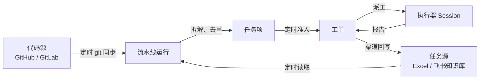

# 010 代码源、任务源与定时流水线

> 已废弃：`pipeline` 来源、其运行时与相关设置项已在 P3 删除；任务改由任务来源驱动与项目调度承载（见 `docs/011-projects-and-scheduling.md`）。本文仅保留为历史设计记录。

本文定义 dsh-superagent 的第二条工作入口：**按配置定时拉取代码与任务清单，把清单拆成可执行任务，经现有工单/执行器链路完成，再把结果回写到任务源**。

事件驱动的来源（GitHub、GitLab、飞书，见 [009 来源记录](009-source-records.md)）保持不变；本文件只描述新增的流水线模型。两者共用引擎、策略、执行器和渠道，不新增第二套执行机制。

## 为什么

现有模型解决「有人提出请求，智能体接单」。它不覆盖另一种常见工作：**任务清单已经存在，代码仓库已经指定，只需要按点把清单里的待办逐条做完**。这类工作有三个特征：

- 输入不是事件流，而是可重复读取的清单（Excel 文件、飞书知识库页面）；
- 触发不来自人，而来自时间表；
- 结果需要回到清单本身，而不只是聊天回复。

因此新增一个来源类型 `pipeline`：它是一份用户记录，配置里选代码源、选任务源、选时间表。它不复制来源的读取位置、重试和健康机制，而是复用它们。

## 领域模型

新增的概念只有一个聚合：**流水线**。任务仍是工单，执行仍是派工，回写仍是渠道写入。



| 概念 | 定义 | 规则 |
| --- | --- | --- |
| Pipeline | 一份 `pipeline` 来源记录：代码源、任务源、时间表与回写策略 | 同一记录同一时间至多一次运行；停用后不再产生新工单，已有工单继续 |
| Code source | 代码源配置：指向一条 GitHub 或 GitLab 记录、分支和本地目录 | 只读同步，不覆盖本地未提交内容；凭据来自该记录的 CLI |
| Task source | 任务源配置：`excel` 或 `feishu`，加上列映射与「待办状态」集合 | 只读；读取失败不删除已知任务 |
| Task item | 规范化后的任务：稳定 ID、标题、描述、来源状态、优先级 | 稳定 ID 必须由清单的 `id` 列提供，整张表内唯一；缺失、重复或缺少 `title` 都会整批拒绝并报出行号 |
| Split | 把一条任务的描述按复选框/编号列表拆成可独立执行的工作项 | 拆分结果确定：同样输入得到同样工作项 |
| Pipeline run | 一次运行：同步代码 → 读取任务 → 拆解规划 → 逐条执行 → 回写 | 运行状态持久化；进程重启后从未完成状态继续 |
| Writeback | 把任务项结果写回任务源 | 只在对应工单结束后写一次；写失败单独重试，不重跑工单 |

## 端口与适配器边界

流水线只依赖两个端口，适配器不接触引擎、执行器或策略。

```ts
/** 代码源端口：把远端仓库同步到本地目录，返回被检出的提交。 */
interface CodeSourcePort {
  sync(input: { branch: string; directory: string; signal: AbortSignal }): Promise<{ commit: string; changed: boolean }>
}

/** 任务源端口：读取全部任务项，只做规范化和校验，不做拆分或去重。 */
interface TaskSourcePort {
  /** 缺列、编号缺失或重复时抛出 TaskListError（含逐行问题），由运行器记为本次运行失败。 */
  load(input: { signal: AbortSignal }): Promise<RawTask[]>
}
```

| 端口 | 适配器 | 依赖 | 说明 |
| --- | --- | --- | --- |
| `CodeSourcePort` | `github`、`gitlab` | 现有 `Commands.git` 与按目录分发的凭据助手 | 选择的是来源记录 ID，因此实例地址、账号与凭据都不进入流水线配置 |
| `TaskSourcePort` | `excel` | 本地文件系统 | 支持 `.csv`、`.tsv` 与 `.xlsx`；`.xlsx` 用 Node 内置 `zlib` 读取，不引入第三方解析库 |
| `TaskSourcePort` | `feishu` | 配置中 `feishuSource` 记录上的 `Commands.lark` | 读取知识库节点对应的文档纯文本；未配置机器人凭据时记录为未验证，不影响其他来源 |

适配器选择发生在**运行开始时**：配置写 `kind`，工厂按 `kind` 创建实例。新增任务源类型只需新增适配器并在工厂登记，运行状态机不变。

## 配置 schema

流水线是来源记录的一种，因此配置随记录保存、随记录启停、随记录删除：

```json
{
  "sources": {
    "pipeline": {
      "kind": "pipeline",
      "enabled": true,
      "config": {
        "codeSource": "github",
        "remoteUrl": "",
        "branch": "main",
        "directory": "",
        "taskKind": "excel",
        "feishuSource": "",
        "taskFile": "D:/work/tasks.xlsx",
        "taskSheet": "",
        "wikiUrl": "",
        "columnId": "id",
        "columnTitle": "title",
        "columnDescription": "description",
        "columnStatus": "status",
        "columnPriority": "priority",
        "pendingStatuses": "待处理,todo,pending,open",
        "intervalMinutes": 30,
        "runOnStart": true,
        "concurrency": 1,
        "maxRetries": 2,
        "retryBackoffSeconds": 60,
        "doneStatus": "已完成",
        "failedStatus": "失败"
      }
    }
  }
}
```

| 字段 | 含义 |
| --- | --- |
| `codeSource` | 代码来源记录；面板只列出已安装的 `github` 或 `gitlab` 记录 |
| `remoteUrl` | 可选远端地址；空表示按来源记录生成 HTTPS 地址。可填 `ssh://git@host/owner/repo.git`，不得内嵌账号密码 |
| `branch` | 分支；空表示该来源的默认分支（由 `git ls-remote` 解析远端 HEAD） |
| `directory` | 本地同步目录；空表示 `<stateDir>/pipeline/<记录ID>/code` |
| `taskKind` | `excel` 或 `feishu` |
| `feishuSource` | 读取知识库所使用的飞书来源记录；`taskKind = feishu` 时必填，面板只列出已安装的飞书记录 |
| `taskFile`、`taskSheet` | Excel 文件绝对路径与工作表名；`taskSheet` 为空时取第一张表 |
| `wikiUrl` | 飞书知识库节点 URL、文档 URL 或 token |
| `column*` | 表头到字段的映射；`columnId` 与 `columnTitle` 必填，其余可留空 |
| `pendingStatuses` | 逗号分隔的待办状态集合；状态为空也视为待办 |
| `intervalMinutes` | 运行间隔，最小 1 分钟、最大 1 天 |
| `runOnStart` | 启动后立即运行一次 |
| `concurrency` | 本轮同时在途的工作项上限；实际执行仍受执行器全局 `maxWorkers` 槽位约束（超出排队，不超发） |
| `maxRetries` | 单个任务项在失败后自动重试的次数 |
| `retryBackoffSeconds` | 重试退避基数，按尝试次数指数增长 |
| `doneStatus`、`failedStatus` | 回写状态文案 |

校验规则：

- 记录级校验失败只让该记录进入 `problem` 或等待配置，不静默停用，不影响其他来源；
- `codeSource` 必须指向已安装、类型为 `github` 或 `gitlab` 的记录；
- `remoteUrl` 为空时按记录生成 `https://<站点>/<仓库>.git`；非空时拒绝 `user:pass@` 形式的内嵌凭据；
- `taskKind = excel` 时 `taskFile` 必须是非空绝对路径；`taskKind = feishu` 时 `wikiUrl` 与 `feishuSource` 必填；
- 列映射中 `columnId`、`columnTitle` 必填，其余可留空；
- `concurrency` 只限制本记录一轮在途的工作项数，不改变执行器的全局槽位（`extensions.executor.maxWorkers`）；超出槽位的工单排队等待。

## 调度模型

### 定时拉取

每条 `pipeline` 记录由 `SourceAdapter.watch` 运行自己的循环，与 GitHub/GitLab/飞书记录相同：

1. 记录未启用或未配置：每分钟检查一次配置，不运行；
2. `runOnStart` 为真时立即运行一次；
3. 之后每 `intervalMinutes` 运行一次；
4. 任一次运行失败只影响本次运行；下一次按时间表继续；
5. 运行期间收到停止信号：当前步骤不再启动新任务，已启动工单不受影响。

运行之间**不重叠**：`watchPipeline` 是单循环顺序执行，上一次 `runPipeline` 返回后才进入等待并开始下一轮，因此同一记录不会并发运行；跨进程由状态目录锁与工单去重 ID 兜底。

### 去重与幂等

| 对象 | 键 | 规则 |
| --- | --- | --- |
| 任务项 | `pipeline-item(record, taskId, index)` | 任务源提供的 `id` 列；不再由内容摘要兜底 |
| 触发器 | `pipeline-task(record, itemKey)` | 同一任务项永远产生同一个触发器 ID |
| 工单 | `ticket(triggerId)` | 已存在即跳过，不新建、不改写 |
| 已知任务 | KV `pipeline-items:<record>`、运行状态 `pipeline-state:<record>` | 保存阶段、终态、尝试次数与工单 ID，用于重启续跑 |
| 代码同步 | 运行记录中的 `commit` | 仅作审计；不决定是否执行任务 |

因此：重复读取同一份清单不会重复开单；进程在「已开单、未回写」时重启，只会补回写，不会重跑。

### 清单导入契约

- 第一行必须是表头；`columnId` 与 `columnTitle` 指向的列必须存在，拼错时错误信息会带上当前表头的实际列名；
- 每一行都必须有非空 `id` 与 `title`，`id` 在整张表内唯一；
- 只有表头、没有数据行也会报错；
- 任一行不满足即**整批拒绝**，错误按行号汇总（最多逐条列出 5 处，其余注明数量），写入运行状态 `failed` 的 `detail` 与 `pipeline:tasks` 健康详情，不再出现“成功导入 0 条”；
- 状态不在 `pendingStatuses` 的任务不算错误，运行状态里记录本轮跳过数量。

### 工单目录

- 工单目录为 `<executionRoot>/<项目名称>/<工单ID>`，`executionRoot` 取 `executor.directory`，为空时取 `<stateDir>/work`；
- 项目名称取来源记录项目标识的最后一段：GitHub 用 `repository`，GitLab 用 `project`；没有项目标识的来源（飞书）退回记录 ID；
- 两条记录映射到同一名称时，两条都追加记录 ID（`<名称>-<记录ID>`），不会静默共用一个目录；
- 名称会去掉 Windows 非法字符与首尾点、空格，保留设备名（`CON`、`NUL`、`COM1` 等）加 `project-` 前缀；
- 项目层保留分组、归属与多项目扩展；每张工单在项目目录下拥有以工单 ID 命名的子目录，**同一项目的多张工单并发执行时各写各的产物，互不覆盖**，因此不需要同项目串行，并发契约仍是全局 `executor.maxWorkers`；
- 工单子目录名与项目名同一套清洗规则；清洗会改变 ID 时追加原 ID 的 12 位哈希，空结果退回 `ticket-<哈希>`，不同工单不会因清洗落到同一目录；
- `executor.prepare` 在工单子目录不存在时运行，工作目录是所属项目目录，命令通过 `DSH_SUPERAGENT_DIR` 创建该工单自己的目录；同一工单重试复用已准备好的子目录；
- **不迁移**旧版本按项目命名的目录（`<executionRoot>/<项目名称>`）和更早按工单命名的目录，旧目录保留原样。

### 按项目配额

- 全局并发由 `executor.maxWorkers` 决定，它是唯一硬上限；
- 单个项目同时只运行一个工单，固定为 1，不可配置；
- 人的消息唤醒工作单元与自动启动共用全局槽位，不额外占一个，也不绕过项目串行；
- 达到项目上限的启动保持排队，待该项目槽位释放后继续；
- 项目名与工单目录使用同一个名称；同名项目来自不同来源记录时按记录 ID 分开，各自计算配额。

### 拆解

拆解是**纯函数**，输入一条任务项，输出 0..n 个工作项：

- 描述中的 Markdown 复选框（`- [ ]`、`* [ ]`、`1. [ ]`）各成一个工作项；
- 描述中的编号列表（`1.`、`2.`）在复选框不存在时各成一个工作项；
- 其余情况整条任务就是一个工作项；
- 每个工作项继承任务项的标题、状态与来源链接，标题为 `任务标题 / 子项文本`。

工作项 ID 由任务项 ID 与子项序号派生，保证稳定。

## 状态机

### 运行状态

```
idle → syncing-code → loading-tasks → planning → running → writing-back → done
  ↘ failed（任一步骤抛错，记录原因与下一次重试时间）
```

- `syncing-code`：`git` 同步；失败时进入 `failed`，不读取任务、不开单。
- `loading-tasks`：任务源读取；失败时 `failed`，保留上一次已知任务。
- `planning`：规范化、状态过滤、拆解、去重，得到本轮待执行工作项。
- `running`：按并发上限逐项开单或复用已有工单，等待其结束。
- `writing-back`：对已结束工单批量回写；单项写失败不阻塞其他项。
- `done`：记录耗时、提交、开单数与回写数。

### 任务项状态

```
discovered → queued → running → succeeded → written-back
                    ↘ failed（未达 maxRetries，下一次运行重新准入）
                             → failed（达到上限，作为终态等待人工）
```

状态由流水线运行器写 KV；工单状态仍由引擎写。两边通过工单 ID 关联，不复制工单字段。没有 `skipped` 状态：不符合导入契约的行整批拒绝，状态过滤只体现在运行摘要里。

## 失败重试与并发

- **运行级**：失败后不立即重试，按 `intervalMinutes` 等到下一次时间表；`failed` 原因写入该记录健康与运行记录。
- **任务级**：工单报告 `failed`/`blocked` 且未达 `maxRetries` 时，下一次运行重新准入（同一工单 ID，不重复开单）；达到上限后保持 `failed` 终态并在面板显示。
- **回写级**：回写失败单独计数，独立于工单重试；工单成功不回退。
- **并发**：`concurrency` 是本轮同时在途的工作项上限（实际取值 `max(1, concurrency)`），未与 `executor.maxWorkers` 取较小值；超出执行器全局槽位的工单由执行器排队，不超发。流水线不抢占其他来源的工单槽位。
- **崩溃恢复**：启动时对仍为 `running` 的任务项，若对应工单已丢失则写为 `failed` 并记录原因；工单仍存在则保持 `running`，继续等待它结束。

## 凭据读取

- 代码源不新增凭据字段：`git` 通过现有 `worker-gitconfig` 的凭据助手按目录选择来源记录，选择逻辑与工单目录一致；
- 流水线同步目录在首次同步时登记到该来源记录（`recordTicketSource`），因此凭据、实例地址和 CLI 都不进入流水线配置；
- `remoteUrl` 只改 `origin` 地址，不改凭据选择：`https://` 远端仍由该目录绑定的记录提供凭据；`ssh://` 远端使用宿主 SSH 身份，而 `worker-gitconfig` 的 `insteadOf` 会把 `git@github.com:` 改写成 HTTPS，因此 SSH 地址应写成 `ssh://` 形式；
- 飞书任务源通过该记录的 `lark-cli` 以机器人身份读取，令牌由 CLI 自身保存；
- 任何 token、cookie、密码都不得写入设置、运行记录、健康详情或日志；错误信息只保留脱敏后的 CLI stderr。

## 与现有核心的接口

流水线通过一个新增的引擎命令把任务项变成工单：

```ts
/** 定时准入：按流水线配置直接创建工单，不经过模型评估。 */
interface EngineForPipeline {
  schedule(input: {
    trigger: Trigger
    title: string
    scope: string
    name: string
    note?: string
  }): { ticketId: string; created: boolean }
}
```

授权依据是新增的 `MandateBasis` 分支 `{ via: 'scheduled', source: '<记录ID>', task: '<任务项ID>' }`：

- 强度固定为 `explicit`，因为配置本身就是人的明确授权；
- `revalidate` 要求流水线记录仍存在、启用，且任务源配置仍有效；停用或删除后，未结束的工单不再自动恢复；
- 不走准入表、不匹配规则，因此策略里的规则、允许名单与评估模式不参与定时准入；
- 工单的来源触发器仍被保存，回写与审计都按触发器 ID 定位。

这是对 [001 领域模型](001-domain.md)「只有评估能创建工单」的一处**明确扩展**：定时任务源是第二个授权入口，写入本文与领域文档。

## 回写与提交

- 代码提交由执行器 Session 完成，沿用现有执行与提示词，不在流水线里重复实现 git 提交；
- 回写只更新任务源的状态列：全部工作项成功 → `doneStatus`，存在达到重试上限的失败项 → `failedStatus`；
- Excel 回写：`.csv` / `.tsv` 只改匹配行的状态单元格；`.xlsx` 只改匹配行的状态单元格并把值写成内联字符串，保留该单元格的样式属性，其余 ZIP 条目直接复制原始压缩数据，先写临时文件再原子替换；
- 飞书写回：需要文档块接口，且本机没有可用凭据，当前明确报未支持，不做降级猜测；
- 回写失败单独记为 `writeback-failed`，不回退已完成的工作，也不重跑工单；
- `.xlsx` 回写已用真实工作簿往返验证：状态更新后单元格样式、列宽、行高、冻结窗格、合并单元格与其余工作表保持不变；状态列若由公式生成，回写会以文本替换该单元格，使用前请确认状态列允许手填。

## 迁移与删除清单

本次**不删除**现有能力：事件驱动来源、策略、评估、执行器与渠道都被流水线复用。逐项证据：

| 候选旧实现 | 结论 | 仓库内证据 |
| --- | --- | --- |
| `github-watch` / `gitlab-watch` / `feishu-watch` 独立插件条目 | 早已删除，不在本次范围 | 全仓搜索仅命中 `docs/009`、`docs/010`、`verification/` 与 `.trae/` 历史方案，`src/` 无命中 |
| 单来源迁移与旧配置读取 | 早已删除 | 全仓无单来源迁移代码，来源配置只按当前记录读取 |
| 架构迁移与旧库兼容 | 已删除 | 本版本只接受当前架构；空库建基线，其他架构启动即报错并提示 `reset`，不做任何升级转换 |
| 现有 GitHub/GitLab/飞书适配器 | 保留 | `src/sources/adapters.ts` 仍注册三者，`tests/sources.spec.ts`、`tests/gitlab.spec.ts` 覆盖 |
| 现有工单/执行器/渠道 | 保留 | `src/core/tickets.ts`、`src/executor/dsh.ts`、`src/app/outbox.ts` 均被流水线直接调用 |
| 旧的「每种类型只能一条记录」假设 | 不需要删除 | 009 已完成记录化；`firstSource` 仍用于部署摘要与飞书面板开关，删除会改变现有面板行为 |

新增文件全部落在 `src/pipeline/` 与对应测试，`007 架构` 的模块表与测试表同步登记；不新增子路径导出、不引入第三方依赖。

## 未验证项

| 项 | 原因 | 处理 |
| --- | --- | --- |
| 飞书知识库真实读取与回写 | 只读探测本机 `lark-cli auth status` 返回 `config/not_configured`（exit 3），环境变量中没有飞书应用凭据，也没有已登录的机器人身份 | 接口、配置与错误路径已实现并标注未验证；不索要、不外传任何 token。启用条件：在本机交互执行 `lark-cli config init --new` 完成授权，并提供一个机器人可读的知识库文档节点；回写还需要文档块写权限，当前代码明确报未支持 |
| 真实模型执行任务 | 需要可用模型与 DSH 会话 | 使用真实执行器接口与假执行器分别验证准入与状态机 |
